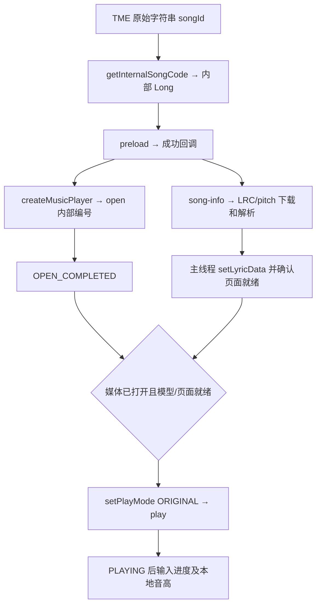

# Android K歌融合接入指南：MCC（音集协）与 TME

本文面向在自己的 Android 工程中接入 RTC SDK 和 KaraokeView 的开发者，分别说明两条曲库从选歌、资源获取到播放、内部评分的完整流程。

接口基线为本仓库 `dev/6.0` 当前使用的 `app/libs/agora-rtc-sdk.jar` 及配套原生库，按 2026-11-03 的 Java 接口和歌词组件源码核对。SDK JAR 的 Manifest 没有产品版本号；请以交付 SDK 的完整包为版本单位，运行时可用 `RtcEngine.getSdkVersion()` 记录实际版本。不要将本文接口直接套用到旧 SDK 或旧 Maven 包。

本文参考 [原集成文档](K歌融合集成文档.md) 重新编写。原文中的 `addVendor`、`startScore`、`scoreEventHandler` 不属于当前 JAR 的 API；当前使用 `MusicContentCenterConfiguration` 初始化、RTC 播放器播放、KaraokeView 内部评分，不需要 MCCEx 插件。

## 1. 先区分两条接入链路

这里的“MCC（音集协）”指音集协曲库；SDK 的 `IAgoraMusicContentCenter` 本身是两条链路共用的音乐内容中心。

| 环节 | MCC／音集协 | TME |
| --- | --- | --- |
| SDK vendor 常量 | `MUSIC_CONTENT_CENTER_VENDOR_ID_YJX = 1` | `MUSIC_CONTENT_CENTER_VENDOR_ID_TME = 2` |
| 获取 songs | `getMusicCharts` → `getMusicCollectionByMusicChartId`，或 `searchMusic` | `sendExtRequest`，`actionType="songs"` |
| 列表返回 | `onMusicChartsResult`、`onMusicCollectionResult`；SDK 已构造 `Music[]` | `onExtResponse`；业务／歌词组件解析 JSON |
| 歌曲信息 | 列表中的 `Music`；可补充 `getSongSimpleInfo` | `sendExtRequest`，`actionType="song-info"` |
| 歌曲 ID | `Music.songCode: Long` | 原始 `songId: String`，保留前导零 |
| 播放编号 | 本流程直接使用 `Music.songCode` | `getInternalSongCode(0L, jsonOption)` 返回的内部 `Long` |
| 计分资源 | `getLyric(songCode, 0)` 获取 XML URL；XML 可包含参考音高 | `song-info` 中的 LRC URL 和独立 `pitchUrl` |
| 文件解析 | `KaraokeView.parseLyricData(xmlFile, null)` | `KaraokeView.parseTMEToneData(pitchPath, lrcPath)` |
| 播放 | `preload` → `open` → `play` | 编号转换 → `preload` → `open` → `play` |
| 评分 | `setLyricData(model, true)`，输入真实进度和本地音高 | 同左，使用 TME 专用模型及可计分句数 |

当前 Android JAR 将音集协的曲榜、搜索、`getSongSimpleInfo` 和 `getLyric` 标记为 `@Deprecated`，但仍保留这些可调用接口，当前 Demo 的 XML 流程也使用它们。本文说明这条可核对的音集协接入路径；这些接口不能拿来查询 TME。`sendExtRequest` 是通用扩展入口，但仓库没有提供音集协对应的完整 action 请求／响应协议，不能将 TME 的 `songs` JSON 修改成 `vendorId=1` 来猜测。接入方若要求完全使用未废弃的音集协扩展协议，需要取得配套服务协议后再替换该部分。

SDK vendor ID 与 Demo 的页面偏好值不同：Demo 的 MCC 服务存储值为 `0`，不是 SDK 的音集协 vendor ID `1`。

阅读入口：[公共初始化](#3-公共初始化和回调路由)、[MCC 歌曲列表与信息](#4-mcc音集协获取-songs-和歌曲信息)、[MCC XML 下载](#5-mcc音集协预加载下载-xml-和准备评分)、[TME songs](#6-tme获取-songs-并解析-response)、[TME 歌词和 pitch](#7-tme歌曲信息歌词pitch-下载和模型解析)、[TME 媒体预加载](#8-tme转换播放编号与预加载)、[播放控制](#9-共用播放打开发布音轨原唱伴奏)、[内部评分](#10-共用内部评分参考模型进度麦克风音高和结果)。

## 2. 引入 SDK、歌词组件与凭据

### 2.1 依赖和构建

当前工程使用本地 SDK：

```text
app/libs/agora-rtc-sdk.jar
app/src/main/jniLibs/arm64-v8a/  # 同一交付 SDK 的完整原生库
karaoke_view_ex/               # 当前歌词组件源码
```

```groovy
dependencies {
    implementation fileTree(dir: 'libs', include: ['*.jar', '*.aar'])
    implementation project(':karaoke_view_ex')
}
```

独立工程也可引入从当前源码构建的歌词 AAR，并配置其传递依赖。需要确认包内具有 `TMERequestManager`、`TMEScoringPreparation` 和 `KaraokeView.parseTMEToneData`；仅使用相同版本名称不能保证远端已有这些新增接口。RTC 的 JAR 与各 ABI 的 `.so` 必须来自同一份交付包。

当前仓库构建使用 Gradle Wrapper `7.4`、AGP `7.3.1`、JDK 17，Java/Kotlin 目标为 1.8，compile/target SDK 为 34。Demo minSdk 21，歌词库 minSdk 17；实际应用的最低系统要求还需满足配套 RTC SDK。源码构建使用仓库配置的 NDK `28.2.13676358` 和 CMake `3.22.1`。

### 2.2 权限与账号

```xml
<uses-permission android:name="android.permission.INTERNET" />
<uses-permission android:name="android.permission.ACCESS_NETWORK_STATE" />
<uses-permission android:name="android.permission.RECORD_AUDIO" />
```

采集前取得 `RECORD_AUDIO` 运行时权限。歌词／pitch 下载到应用 `cacheDir`，这条流程不需要申请共享存储权限。

| 凭据 | 用途 |
| --- | --- |
| App ID、RTC token、频道名、RTC uid | 创建 RTC、加入频道、采集和发布音频 |
| MCC token、mccUid | 初始化音乐内容中心；用户及曲库权限需匹配 |
| 可选 mccDomain | 使用账号获配的音乐服务环境；未指定时使用 SDK 默认值 |

正式应用从自己的服务端获取 token。Demo 的 `APP_CERTIFICATE` 和本地 token builder 属于调试实现。`mccDomain` 不是所有应用都应固定的测试域名；TME 访问默认环境出现 404 时，应先核对账号所对应的服务环境。MCC token 更新接口是 `mcc.renewToken(newToken)`。

## 3. 公共初始化和回调路由

示例使用 Kotlin。后续代码是可组合的接入函数／适配器，不是一份完整 Activity；UI、超时提示和用户重试由业务实现。示例中的接入对象在主线程创建和调用，网络及文件解析放到工作线程。以下导入供后续 Kotlin 示例共用：

```kotlin
import android.content.Context
import android.os.Handler
import android.os.Looper
import io.agora.rtc2.ChannelMediaOptions
import io.agora.rtc2.Constants
import io.agora.rtc2.IRtcEngineEventHandler
import io.agora.rtc2.RtcEngine
import io.agora.rtc2.RtcEngineConfig
import io.agora.musiccontentcenter.IAgoraMusicContentCenter
import io.agora.musiccontentcenter.IAgoraMusicPlayer
import io.agora.musiccontentcenter.IAgoraMusicPlayer.MusicPlayMode
import io.agora.musiccontentcenter.IMusicContentCenterEventHandler
import io.agora.musiccontentcenter.Music
import io.agora.musiccontentcenter.MusicChartInfo
import io.agora.musiccontentcenter.MusicContentCenterConfiguration
import io.agora.karaoke_view_ex.KaraokeView
import io.agora.karaoke_view_ex.KaraokeEvent
import io.agora.karaoke_view_ex.model.LyricModel
import io.agora.karaoke_view_ex.internal.model.LyricsLineModel
import io.agora.karaoke_view_ex.tme.*
import java.io.File
import java.net.HttpURLConnection
import java.net.URL
import java.util.UUID
import java.util.concurrent.Executor
import org.json.JSONObject
```

### 3.1 创建 RTC 并入会

```kotlin
fun createRtc(
    context: Context, appId: String, rtcToken: String,
    channel: String, uid: Int, handler: IRtcEngineEventHandler
): RtcEngine {
    val rtc = RtcEngine.create(RtcEngineConfig().apply {
        mContext = context.applicationContext
        mAppId = appId
        mChannelProfile = Constants.CHANNEL_PROFILE_LIVE_BROADCASTING
        mAudioScenario = Constants.AUDIO_SCENARIO_CHORUS
        mEventHandler = handler
    })
    check(rtc.enableAudio() == 0)
    check(rtc.enableAudioVolumeIndication(50, 3, true) == 0)
    check(rtc.joinChannel(rtcToken, channel, uid, ChannelMediaOptions().apply {
        clientRoleType = Constants.CLIENT_ROLE_BROADCASTER
        publishMicrophoneTrack = true
        autoSubscribeAudio = true
    }) == 0)
    return rtc
}
```

`joinChannel` 返回 `0` 表示请求已提交，真正入会成功由 `onJoinChannelSuccess` 确认。业务按自身会话策略决定何时开放播放／演唱；当前 Android Demo 在提交入会后初始化 MCC，未要求只能在入会成功回调中创建 MCC。

示例使用 `check` 展示成功条件。应用应将失败转成可恢复状态，并清理此前创建的资源。

### 3.2 建立唯一的 MCC 回调入口

SDK 的 `IMusicContentCenterEventHandler` 要求实现六个方法。下列适配器保留完整签名，并统一转主线程；后续各节向对应字段安装处理逻辑。

```kotlin
class MccEvents : IMusicContentCenterEventHandler {
    private val main = Handler(Looper.getMainLooper())
    var charts: (String, Array<out MusicChartInfo>, Int) -> Unit = { _, _, _ -> }
    var collection: (String, Int, Int, Int, Array<out Music>, Int) -> Unit =
        { _, _, _, _, _, _ -> }
    var lyric: (String, Long, String?, Int) -> Unit = { _, _, _, _ -> }
    var info: (String, Long, String, Int) -> Unit = { _, _, _, _ -> }
    var ext: (String, String, Int, String) -> Unit = { _, _, _, _ -> }
    var preload: (String, Long, Int, String?, Int, Int) -> Unit =
        { _, _, _, _, _, _ -> }

    override fun onMusicChartsResult(id: String, list: Array<out MusicChartInfo>?, error: Int) {
        main.post { charts(id, list ?: emptyArray(), error) }
    }
    override fun onMusicCollectionResult(
        id: String, page: Int, pageSize: Int, total: Int,
        list: Array<out Music>?, error: Int
    ) { main.post { collection(id, page, pageSize, total, list ?: emptyArray(), error) } }
    override fun onLyricResult(id: String, code: Long, url: String?, error: Int) {
        main.post { lyric(id, code, url, error) }
    }
    override fun onSongSimpleInfoResult(id: String, code: Long, json: String, error: Int) {
        main.post { info(id, code, json, error) }
    }
    override fun onExtResponse(id: String, option: String, http: Int, body: String) {
        main.post { ext(id, option, http, body) }
    }
    override fun onPreLoadEvent(
        id: String, code: Long, percent: Int, url: String?, status: Int, error: Int
    ) { main.post { preload(id, code, percent, url, status, error) } }
}
```

统一 `post` 还有一个用途：避免 SDK 同步回调先于请求函数返回，使 `requestId` 尚未保存。每次切歌／重建还需要业务会话代次校验；不能仅凭同一个 songCode 就接受上一轮播放的回包。

### 3.3 初始化 MCC

```kotlin
fun initializeMcc(
    mcc: IAgoraMusicContentCenter, appId: String, mccUid: Long,
    mccToken: String, events: MccEvents, domain: String = ""
) {
    check(mcc.initialize(MusicContentCenterConfiguration().apply {
        this.appId = appId
        this.mccUid = mccUid
        token = mccToken
        eventHandler = events
        if (domain.isNotBlank()) mccDomain = domain
    }) == 0)
}
```

调用次序是 `IAgoraMusicContentCenter.create(rtc)` → 创建 `MccEvents` 及业务处理对象 → `initializeMcc(...)`。MCC 和 TME 使用相同的初始化 API；曲库选择体现在查询接口或 TME 扩展请求的 `vendorId` 中，不调用旧版 `addVendor`。

## 4. MCC（音集协）：获取 songs 和歌曲信息

### 4.1 通过曲榜或搜索获取歌曲列表

| 请求 | 返回 | 结果回调 |
| --- | --- | --- |
| `getMusicCharts()` | `String requestId` | `onMusicChartsResult` |
| `getMusicCollectionByMusicChartId(chartId, page, pageSize)` | `String requestId` | `onMusicCollectionResult` |
| `searchMusic(keyword, page, pageSize)` | `String requestId` | `onMusicCollectionResult` |
| `getSongSimpleInfo(songCode)` | `String requestId` | `onSongSimpleInfoResult` |

分页从 `1` 开始，每页最多 `50`。曲榜 ID 来自 `MusicChartInfo.type`，不是榜单名称。四参数版本的列表／搜索 API 还接受 `jsonOption`；本流程使用 SDK 保留的三参数重载。

下面封装只做请求关联和结果转交，直接调用 RTC API，不依赖 Demo 管理器：

```kotlin
class MccCatalog(
    private val mcc: IAgoraMusicContentCenter, events: MccEvents,
    onCharts: (List<MusicChartInfo>) -> Unit,
    onSongs: (List<Music>, Int, Int) -> Unit,
    onInfo: (Long, JSONObject) -> Unit,
    private val onError: (String) -> Unit
) {
    private var chartId: String? = null
    private var collectionId: String? = null
    private var infoId: String? = null

    init {
        events.charts = { id, charts, error ->
            if (id == chartId) {
                chartId = null
                if (error == 0) onCharts(charts.toList()) else onError("charts:$error")
            }
        }
        events.collection = { id, page, _, total, songs, error ->
            if (id == collectionId) {
                collectionId = null
                if (error == 0) onSongs(songs.toList(), page, total)
                else onError("collection:$error")
            }
        }
        events.info = { id, songCode, json, error ->
            if (id == infoId) {
                infoId = null
                if (error != 0) onError("song-info:$error")
                else {
                    val parsed = runCatching { JSONObject(json) }.getOrNull()
                    if (parsed == null) onError("song-info:invalid-json")
                    else onInfo(songCode, parsed)
                }
            }
        }
    }
    private fun accepted(id: String?): String =
        requireNotNull(id?.takeIf { it.isNotEmpty() }) { "MCC request rejected" }

    fun loadCharts() { chartId = accepted(mcc.getMusicCharts()) }
    fun loadSongs(chart: Int, page: Int = 1, pageSize: Int = 20) {
        require(page >= 1 && pageSize in 1..50)
        collectionId = accepted(mcc.getMusicCollectionByMusicChartId(chart, page, pageSize))
    }
    fun search(keyword: String, page: Int = 1, pageSize: Int = 20) {
        require(page >= 1 && pageSize in 1..50)
        collectionId = accepted(mcc.searchMusic(keyword, page, pageSize))
    }
    fun loadInfo(songCode: Long) { infoId = accepted(mcc.getSongSimpleInfo(songCode)) }
    fun invalidate() { chartId = null; collectionId = null; infoId = null }
}
```

使用 `loadCharts()` 得到榜单，选中某项后调用 `loadSongs(chart.type)`；也可以直接调用 `search(keyword)`。`onSongs` 的 `page`、`total` 用于分页界面。发送成功与业务结果成功是两件事：非空请求 ID 后仍需检查回调的 `errorCode`。

### 4.2 如何解析列表 response

音集协列表不走 TME JSON 解析器。SDK 已把响应转换成 `Music[]`，可直接读取：

| 当前 `Music` 字段 | 含义／使用点 |
| --- | --- |
| `songCode: Long` | 预加载、歌词查询、元数据查询、播放使用的歌曲编号 |
| `name`、`singer`、`poster`、`releaseTime` | 列表展示及基础信息 |
| `durationS: Int` | 时长，单位秒；播放器位置另用毫秒 |
| `lyricTypes: Int[]` | 可用歌词格式；本流程申请 XML，即 `0` |
| `type`、`pitchType` | 资源类型信息，保留 SDK 值 |
| `mvProperties`、`climaxSegments` | SDK 返回的扩展媒体／片段信息 |

`getSongSimpleInfo` 是可选补充查询，回调给出 JSON 字符串。上例解析为 `JSONObject` 后交给业务；当前 Java 接口没有为其声明固定字段模型，因此不将旧文档中的 `lyricPath/pitchPath/songOffsetBegin` 假定为它的必返字段。播放和展示所需的已确认基础字段来自 `Music`，XML URL 由下一节专用歌词接口获取。

当前 Demo 的音集协选歌列表使用配置的三首歌曲，未实现在线曲榜展示；接入自己的应用时，使用上面的 SDK 接口获取实际 songs，不需要复制这个固定列表。

## 5. MCC（音集协）：预加载、下载 XML 和准备评分

完整顺序：选定 `Music.songCode` → `isPreloaded/preload` → `getLyric(songCode, 0)` → `onLyricResult` 获取 URL → 下载 XML → 后台解析 → 主线程安装模型 → 打开并播放。

| API／回调 | 必须区分的语义 |
| --- | --- |
| `isPreloaded(songCode)` | 返回 `0` 表示已预加载，不是 Boolean |
| `preload(songCode)` | 返回 `String requestId` |
| `preload(songCode, jsonOption)` | 另一个重载返回 `Int`；不要当请求 ID 使用 |
| `onPreLoadEvent` | 成功判断包含 `status == 0 && errorCode == 0 && percent == 100` |
| `getLyric(songCode, 0)` | `0=XML`；`1=LRC`，这里优先选 XML 用于内部评分 |
| `onLyricResult` | 返回资源 URL，应用还需要下载；不是本地绝对路径 |

### 5.1 下载器和 XML 解析

以下同步函数仅在工作线程调用。文件保留 `.xml` 后缀，便于歌词组件识别格式：

```kotlin
fun downloadResource(rawUrl: String, destination: File) {
    val url = URL(rawUrl)
    require(url.protocol == "https" || url.protocol == "http")
    val connection = url.openConnection() as HttpURLConnection
    connection.connectTimeout = 15_000
    connection.readTimeout = 30_000
    try {
        check(connection.responseCode in 200..299) { "Resource HTTP failure" }
        connection.inputStream.use { input ->
            destination.outputStream().use { output -> input.copyTo(output) }
        }
        check(destination.length() > 0) { "Empty resource" }
    } finally {
        connection.disconnect()
    }
}

fun loadMccXml(
    rawUrl: String, cacheRoot: File, worker: Executor,
    onResult: (Result<LyricModel>) -> Unit
) {
    val main = Handler(Looper.getMainLooper())
    worker.execute {
        val directory = File(cacheRoot, "mcc-lyrics/${UUID.randomUUID()}")
        val xml = File(directory, "song.xml")
        val result = runCatching {
            check(directory.mkdirs())
            downloadResource(rawUrl, xml)
            requireNotNull(KaraokeView.parseLyricData(xml, null)) { "Invalid XML" }
        }
        xml.delete()
        directory.delete()
        main.post { onResult(result) }
    }
}
```

下载 URL 原样使用，保留签名参数与编码。HTTP 是否可用仍受应用网络安全配置约束；下载失败不能直接安装空模型并显示正常评分。正式下载器补充取消、重定向策略及下载上限；上例展示接口衔接和 HTTP／空文件检查。

### 5.2 把预加载回调接到 XML 准备

```kotlin
fun prepareMccXml(
    mcc: IAgoraMusicContentCenter, events: MccEvents, songCode: Long,
    cacheRoot: File, worker: Executor,
    onReady: (LyricModel) -> Unit, onError: (String) -> Unit
): () -> Unit {
    var active = true
    var preloadId: String? = null
    var lyricId: String? = null
    var lyricRequested = false
    fun requestLyric() {
        if (!active || lyricRequested) return
        lyricRequested = true
        lyricId = mcc.getLyric(songCode, 0)
        if (lyricId.isNullOrEmpty()) { active = false; onError("lyric-rejected") }
    }
    events.preload = { id, code, percent, _, status, error ->
        if (active && id == preloadId && code == songCode) {
            if (status != 0 || error != 0) { active = false; onError("preload:$error") }
            else if (percent == 100) requestLyric()
        }
    }
    events.lyric = { id, code, url, error ->
        if (active && id == lyricId && code == songCode) {
            lyricId = null
            if (error != 0 || url.isNullOrBlank()) {
                active = false; onError("lyric:$error")
            } else loadMccXml(url, cacheRoot, worker) { result ->
                if (active) {
                    active = false
                    result.fold(onReady) { onError("xml-download-or-parse-failed") }
                }
            }
        }
    }
    if (mcc.isPreloaded(songCode) == 0) requestLyric()
    else {
        preloadId = mcc.preload(songCode)
        if (preloadId.isNullOrEmpty()) { active = false; onError("preload-rejected") }
    }
    return { active = false }
}
```

返回的取消函数用于切歌／退出时使旧回调失效；进行中的简化 HTTP 下载会在工作线程结束并清理自己的目录。业务为预加载、歌词查询和下载增加阶段超时；不要因为回调迟到而无限等待。

XML 中可直接包含 `tones` 参考音高，`parseLyricData(xml, null)` 允许第二参数为空。解析后检查 `model.hasPitch`：没有参考音高只能展示歌词，不能承诺内部评分。单独下载 LRC 并不等价于已经具备 pitch；本条音集协接口也没有通用的独立 `pitchUrl` 回调，不应沿用 MCCEx 的本地文件 payload。

## 6. TME：获取 songs 并解析 response

### 6.1 当前 SDK 的扩展请求接口

```text
String sendExtRequest(String jsonOption)
void onExtResponse(String requestId, String jsonOption, int httpCode, String response)
```

`sendExtRequest` 返回非空 `requestId` 才表示已提交；HTTP 和业务成功由响应判断。`onExtResponse` 的四个参数必须一起转交解析器；其中 `jsonOption` 是请求参数，用于识别 `vendorId/actionType`，`response` 才是返回体。

首页请求：

```json
{
  "vendorId": 2,
  "actionType": "songs",
  "actionParameter": { "queryInfo": "", "limit": 20 }
}
```

返回体示例，仅展示字段结构，不是可直接播放的真实资源：

```json
{
  "code": 0,
  "msg": "ok",
  "data": {
    "songList": [
      {
        "songId": "00123456",
        "songName": "示例歌曲",
        "status": 1,
        "grantStatus": 1,
        "artistList": [{ "artistId": "a1", "artistName": "示例歌手" }]
      }
    ],
    "nextQueryInfo": "next-page-cursor"
  }
}
```

解析顺序：检查 HTTP 2xx → 检查整数 `code == 0` → 读取 `data.songList` → 每项保留字符串 `songId` 和 `songName` → 保存可选 `nextQueryInfo`。下一页按服务分页契约把游标作为 `queryInfo` 发送，不能把它当整数页码。

不要把 `songId` 转为 Long 再转回来；`"00123456"` 和 `"123456"` 是不同的原始标识。可用性判断可参考当前 Demo：`status` 或 `grantStatus` 存在且不等于 `1` 的歌曲过滤；字段缺失不自动当成拒绝。

### 6.2 使用歌词组件的响应解析器

RTC SDK 负责传输 JSON；`TMERequestManager` 和结果模型来自歌词组件，不是 RTC SDK API。下面两个独立 manager 分别管理 songs 和手动 song-info 查询，避免一次请求覆盖另一个并发任务：

```kotlin
class TmeQueries(
    private val mcc: IAgoraMusicContentCenter, events: MccEvents,
    onSongs: (TMESongsResult) -> Unit,
    onSongInfo: (TMESongInfoResult) -> Unit,
    onError: (TMEParseError) -> Unit
) : AutoCloseable {
    private val lists = TMERequestManager { option -> mcc.sendExtRequest(option) }
    private val details = TMERequestManager { option -> mcc.sendExtRequest(option) }
    private var listId: String? = null
    private var detailId: String? = null
    var preparation: TMEScoringPreparation? = null
    private val listDelegate = object : TMEParserDelegate {
        override fun onSongs(requestId: String, result: TMESongsResult) = onSongs(result)
        override fun onParseError(requestId: String, jsonOption: String, responseBody: String, error: TMEParseError) = onError(error)
    }
    private val detailDelegate = object : TMEParserDelegate {
        override fun onSongInfo(requestId: String, result: TMESongInfoResult) = onSongInfo(result)
        override fun onParseError(requestId: String, jsonOption: String, responseBody: String, error: TMEParseError) = onError(error)
    }
    init {
        lists.delegate = listDelegate
        details.delegate = detailDelegate
        events.ext = { id, option, http, body ->
            if (preparation?.handleExtResponse(id, option, http, body) != true) {
                when (id) {
                    listId -> lists.onExtResponse(id, option, http, body)
                    detailId -> details.onExtResponse(id, option, http, body)
                }
            }
        }
    }
    fun songs(queryInfo: String = "", limit: Int = 20): String? {
        listId = lists.sendRequest(JSONObject().apply {
            put("vendorId", IAgoraMusicContentCenter.MUSIC_CONTENT_CENTER_VENDOR_ID_TME)
            put("actionType", "songs")
            put("actionParameter", JSONObject().apply {
                put("queryInfo", queryInfo); put("limit", limit)
            })
        }.toString())
        return listId
    }
    fun songInfo(originalSongId: String): String? {
        detailId = details.sendRequest(JSONObject().apply {
            put("vendorId", IAgoraMusicContentCenter.MUSIC_CONTENT_CENTER_VENDOR_ID_TME)
            put("actionType", "song-info")
            put("actionParameter", JSONObject().apply { put("songIdListStr", originalSongId) })
        }.toString())
        return detailId
    }
    override fun close() {
        preparation?.close(); preparation = null
        lists.close(); details.close()
    }
}
```

调用 `queries.songs()`，非空返回值表示接受；结构化列表在 `onSongs` 中异步返回。上例强持有两个 delegate，因为解析器／manager 内部使用弱引用。manager 每个实例仅维护一个当前请求，`sendRequest/stop/close/delegate` 在主线程调用；解析在后台执行，结果回到主线程。

`TMESongsResult.songList` 和 `TMESongInfoResult.songList` 都是 `TMESongDetail` 列表，可读取 `songName`、`artistList`、`album`、`pitchUrl`、`lrcList` 等字段。解析器严格检查字段类型，不将数字 songId 强转成字符串。

解析失败按 `TMEParseError` 区分：`InvalidRequest`、`UnsupportedAction`、`HttpError`、`BusinessError`、`InvalidResponse`。不把 HTTP 成功等同于业务成功，也不把所有列表失败都归因于网络。

## 7. TME：歌曲信息、歌词／pitch 下载和模型解析

### 7.1 查询选中歌曲的信息

调用 `queries.songInfo(originalSongId)` 会发送：

```json
{
  "vendorId": 2,
  "actionType": "song-info",
  "actionParameter": { "songIdListStr": "00123456" }
}
```

返回结构示例：

```json
{
  "code": 0,
  "msg": "ok",
  "data": {
    "songList": [
      {
        "songId": "00123456",
        "songName": "示例歌曲",
        "pitchUrl": "https://example.test/pitch.json?signature=original",
        "lrcList": [
          { "type": "lrc", "url": "https://example.test/song.lrc?signature=original" }
        ]
      }
    ]
  }
}
```

在 `onSongInfo` 中按 `songId == originalSongId` 精确选择条目；`songList` 的第一项不一定就是请求的歌曲。歌曲基础信息与资源地址是同一条目中的不同字段，获取列表后仍应为选中歌曲准备当前有效的资源地址。

资源选择顺序：选择匹配歌曲 → 取第一个 `type == "lrc"` 且 URL 非空的 `lrcList` 项 → 取非空 `pitchUrl` → 分别下载两份文件。不要用 KRC 项替换 LRC，也不要把另一首歌的资源用于当前 songId。

### 7.2 复用完整资料准备组件

`TMEScoringPreparation` 把刚才的 song-info 请求、解析、并行下载、文件校验及模型解析串起来。它通过调用方传入的 `mcc.sendExtRequest` 发请求，不创建新的 RTC、MCC 或播放器。

```kotlin
fun prepareTmeScoring(
    mcc: IAgoraMusicContentCenter, queries: TmeQueries,
    cacheRoot: File, originalSongId: String,
    onReady: (TMEScoringPreparationResult) -> Unit,
    onError: (TMEScoringPreparationError) -> Unit
): TMEScoringPreparation {
    queries.preparation?.close()
    val preparation = TMEScoringPreparation(cacheRoot)
    queries.preparation = preparation
    preparation.listener = object : TMEScoringPreparationListener {
        override fun onStage(stage: TMEScoringPreparationStage) {
            // 可分别展示歌词下载、pitch 下载和解析阶段。
        }
        override fun onSuccess(result: TMEScoringPreparationResult) = onReady(result)
        override fun onFailure(error: TMEScoringPreparationError) = onError(error)
    }
    preparation.prepare(originalSongId) { option -> mcc.sendExtRequest(option) }
    return preparation
}
```

采用此方法时，不需要先手动调用 `queries.songInfo()`；准备组件会自行查询。若仅展示详情，可单独使用上一节的查询，两者的回包分别由 manager／preparation 消费。`TmeQueries` 已把原始 `onExtResponse` 四参数先交给 preparation，再交给列表／详情请求。

组件默认在 `cacheDir/tme-scoring/<UUID>/` 并行下载 `song_lyric.lrc` 和 `song_pitch.json`，两份校验成功后在后台解析，主线程返回内存模型。组件会清理自己创建的临时文件，因此上层应持有 `result.lyricModel`，不要依赖临时路径长期存在。

阶段为 `QUERYING`、`LYRIC_DOWNLOADING`、`LYRIC_DOWNLOADED`、`PITCH_DOWNLOADING`、`PITCH_DOWNLOADED`、`PARSING`；不是下载进度百分比。默认查询超时 30 秒、每份下载 60 秒、整体准备 120 秒，可用 `TMEScoringPreparationTimeouts` 调整。

默认严格模式：缺 LRC／pitch、下载失败或模型不可计分都会失败。希望 pitch 不可用时保留歌词，可在 `prepare` 前设置 `allowLyricsOnly=true` 并实现 `onLyricsOnly(model, error)`；此时只显示歌词，关闭评分。歌词也不可用时由业务选择明确的无歌词播放或停止，不能显示伪造的分数。

### 7.3 自己下载时使用什么解析接口

如果业务已有下载缓存，把上述两个 URL 分别下载为本地文件后调用：

```kotlin
fun parseLocalTmeFiles(pitchFile: File, lrcFile: File): LyricModel {
    return requireNotNull(KaraokeView.parseTMEToneData(
        pitchFile.absolutePath, lrcFile.absolutePath
    )) { "Invalid TME pitch/LRC data" }
}
```

此函数也要放在工作线程。参数顺序是 **pitch JSON 在前，LRC 在后**，不能用普通 `parseLyricData(lrc, null)` 代替完整 TME 计分准备。

pitch 文件本身是音符 JSON 数组，例如：

```json
[
  { "st": 1000, "d": 500, "p": 60 },
  { "st": 1500, "d": 500, "p": 62 }
]
```

`st/d` 为毫秒，`p` 是资源音高编码；解析器换算成参考频率。RTC 的 `voicePitch` 是演唱输入，不要把资源里的 `p` 直接送给 `setPitch`。解析失败、没有有效歌词时间行或没有可计分音符时，该 API 返回 null。

## 8. TME：转换播放编号与预加载

歌曲详情查询和资料准备始终使用原始 `songId: String`。只有媒体预加载／打开使用 SDK 的内部 `Long songCode`：

```kotlin
fun tmeInternalSongCode(mcc: IAgoraMusicContentCenter, originalSongId: String): Long {
    val option = JSONObject().apply {
        put("vendorId", IAgoraMusicContentCenter.MUSIC_CONTENT_CENTER_VENDOR_ID_TME)
        put("actionParameter", JSONObject().apply {
            put("songCode", originalSongId)
            put("fileType", "mkv")
        })
    }.toString()
    return mcc.getInternalSongCode(0L, option).also {
        check(it > 0) { "Song mapping rejected" }
    }
}
```

这里的 `actionParameter.songCode` 装入原始字符串 songId，与返回的内部 Long 不同。编号转换参数没有 `actionType`，不是 songs／song-info 扩展请求，不能交给 TME 响应解析器。

得到内部编号后调用 `mcc.preload(internalSongCode)`，保存返回 ID。在 `events.preload` 中同时匹配当前会话、请求 ID 和内部编号，检查 `status/errorCode/percent`。完成只消费一次，再进行以下两路：



完整预加载判定与上面音集协相同，但 TME 不使用该回调的 `lyricUrl` 代替 song-info。媒体由 SDK 的 `preload/open` 管理，不需要再查询 `song-url` 后自己下载音频文件；歌词及 pitch 下载是另一条应用侧任务。

## 9. 共用播放：打开、发布音轨、原唱／伴奏

### 9.1 创建播放器并打开

播放器来自 `mcc.createMusicPlayer()`，类型为 `IAgoraMusicPlayer`，不是普通网络播放器。为它注册 `IMediaPlayerObserver`，再打开歌曲：

```kotlin
fun openMusicPlayer(
    mcc: IAgoraMusicContentCenter, rtc: RtcEngine, songCode: Long,
    observer: io.agora.mediaplayer.IMediaPlayerObserver
): IAgoraMusicPlayer {
    val player = requireNotNull(mcc.createMusicPlayer())
    try {
        check(player.registerPlayerObserver(observer) == 0)
        check(rtc.updateChannelMediaOptions(ChannelMediaOptions().apply {
            publishMediaPlayerAudioTrack = true
            publishMediaPlayerId = player.mediaPlayerId
        }) == 0)
        check(player.open(songCode, 0L) == 0)
    } catch (failure: Exception) {
        releaseSongPlayer(mcc, rtc, player, observer)
        throw failure
    }
    return player
}
```

`publishMicrophoneTrack` 发布麦克风；`publishMediaPlayerAudioTrack/publishMediaPlayerId` 发布歌曲音轨。两个用途不同；只在本机听见歌曲不能证明远端也收到伴奏。

`IMediaPlayerObserver` 是完整接口，独立应用应实现全部方法，完整方法列表可参考 [MccManager.java](app/src/main/java/io/agora/examples/karaoke_view_ex/agora/MccManager.java) 的 observer。关键状态处理如下：

| `onPlayerStateChanged` 状态 | 动作 |
| --- | --- |
| `PLAYER_STATE_OPEN_COMPLETED` | 标记媒体已打开，检查首次播放门控 |
| `PLAYER_STATE_PLAYING` | 确认实际播放，开放当前会话的进度／音高输入 |
| `PLAYER_STATE_PAUSED` | 关闭进度／音高输入，保留当前模型和分数 |
| `PLAYER_STATE_PLAYBACK_ALL_LOOPS_COMPLETED` | 停止时间驱动并结束当前歌曲 |
| `PLAYER_STATE_FAILED` | 取消资料准备，结束歌曲并释放播放器 |

打开返回 `0` 只表示提交成功，不能立刻调用 `play`。播放器回调统一转主线程并校验当前会话；在切歌后忽略旧 player observer 的迟到状态。

### 9.2 首次播放门控

下面是单曲门控，`pageReady` 表示当前前台页面已经安装模型，或已经明确确认无计分降级。它不是某一个 RTC SDK 状态：

```kotlin
class FirstPlayGate(
    private val player: IAgoraMusicPlayer,
    private val onError: (String) -> Unit
) {
    var mediaOpened = false
    var resourcesReady = false
    var pageReady = false
    var foreground = true
    private var issued = false
    private var closed = false

    fun tryPlay() {
        if (closed || issued || !mediaOpened || !resourcesReady || !pageReady || !foreground) return
        issued = true
        if (player.setPlayMode(MusicPlayMode.MUSIC_PLAY_MODE_ORIGINAL) != 0) {
            onError("original-mode-rejected"); return
        }
        if (player.play() != 0) onError("play-rejected")
    }
    fun close() { closed = true }
}
```

在媒体 OPEN_COMPLETED、资料准备成功、页面安装完成三个入口分别更新条件并调用 `tryPlay()`；`issued` 保证一首歌首次只调用一次。失败回调需要业务释放播放器，重新播放使用新会话。业务补充“打开超时”和“提交 play 后未收到 PLAYING”的超时处理。

MCC 可在 XML 准备成功后调用 `openMusicPlayer`；TME 在预加载完成后可并行打开媒体和 `prepareTmeScoring`。两条链路都应先在主线程执行 `karaoke.setLyricData(model, true)`，确认 View 已就绪后再播放。资料明确失败且用户允许降级时，清空或安装仅歌词模型、关闭评分，再显式满足降级门控；不要让失败回调自动触发有评分的播放。

### 9.3 原唱／伴奏、暂停和跳转

| 操作 | 当前 RTC API |
| --- | --- |
| 原唱 | `player.setPlayMode(MUSIC_PLAY_MODE_ORIGINAL)`，枚举值 `0` |
| 伴奏 | `player.setPlayMode(MUSIC_PLAY_MODE_ACCOMPANY)`，枚举值 `1` |
| 导唱 | `MUSIC_PLAY_MODE_LEAD_SING`，枚举值 `2`；本文 UI 不必暴露 |
| 暂停／恢复 | `player.pause()`／`player.resume()` |
| 跳转 | `player.seek(positionMs)` |
| 当前进度 | `player.getPlayPosition()`，单位毫秒 |

首次播放显式设置 ORIGINAL，不依赖 SDK 默认模式。只有 `setPlayMode` 返回 `0` 才改变界面原唱／伴奏状态；失败保留原状态。不再用手动左右声道或音轨索引切换。

`resume()` 保留用户选择，不重新设置 ORIGINAL；切换模式不需要重新安装歌词模型或重置计分。暂停／后台停止时间及音高输入；恢复后等待 PLAYING 再继续。seek 返回失败时，不应提前跳转歌词或重置已有得分。

## 10. 共用内部评分：参考模型、进度、麦克风音高和结果

### 10.1 初始化显示组件并安装模型

`LyricsView`、`ScoringView` 是 XML 中实际布局的 View；`KaraokeView` 是连接两者的协调对象。取得页面已有的两个 View 后创建 `KaraokeView(lyricsView, scoringView)`。

安装模型在主线程执行：

```kotlin
fun installScoringModel(karaoke: KaraokeView, model: LyricModel): Boolean {
    karaoke.reset()
    karaoke.setLyricData(model, true)
    return model.hasPitch
}
```

返回值用于决定是否开放评分；`true` 参数表示使用歌词组件的内部算法，不是让 RTC 自动启动评分。MCC 参考音高来自 XML；TME 参考音高来自合并 LRC/pitch 后的模型。同一首歌不要每次进度更新都调用 `setLyricData`，否则会重新准备评分状态。

### 10.2 以真实播放器时间驱动组件

下面的输入器由单曲持有；仅在页面前台、播放器 PLAYING、模型可计分时运行。`playing` 必须由播放器状态回调确认，不能只因 `play()` 返回 0 就设为 true：

```kotlin
class ScoreFeed(private val player: IAgoraMusicPlayer, private val karaoke: KaraokeView) {
    private val main = Handler(Looper.getMainLooper())
    var playing = false
    var foreground = true
    var modelReady = false
    var scoringEnabled = false
    private var closed = false
    private fun running() = !closed && playing && foreground && modelReady
    private val tick = object : Runnable {
        override fun run() {
            if (running()) karaoke.setProgress(player.playPosition)
            if (!closed) main.postDelayed(this, 20)
        }
    }
    fun start() { main.removeCallbacks(tick); main.post(tick) }
    fun onLocalPitch(pitch: Double) {
        if (!running() || !scoringEnabled || !pitch.isFinite() || pitch < 0) return
        karaoke.setProgress(player.playPosition)
        karaoke.setPitch(pitch.toFloat(), 0F, 0)
    }
    fun close() { closed = true; main.removeCallbacks(tick) }
}
```

安装模型后设置 `modelReady=true`、`scoringEnabled=model.hasPitch`；仅歌词降级仍可更新时间显示，但 `scoringEnabled=false`。本例每 20ms 读取真实播放器位置，不用系统时间递增估算歌曲时间，也不增加固定的 iOS 进度偏移。

内部评分模式使用 `setProgress` 已提交的时间，因此先更新进度，再 `setPitch(pitch, 0F, 0)`。第二参数不是要求业务先算一个分数，第三参数也不需要重复传外部估算时间。

### 10.3 从 RTC 提取本地演唱音高

将以下逻辑合入创建 RTC 时使用的 `IRtcEngineEventHandler`；应用自己的入会／错误回调继续保留：

```kotlin
fun localPitchHandler(currentFeed: () -> ScoreFeed?): IRtcEngineEventHandler {
    val main = Handler(Looper.getMainLooper())
    return object : IRtcEngineEventHandler() {
        override fun onAudioVolumeIndication(
            speakers: Array<out IRtcEngineEventHandler.AudioVolumeInfo>?, totalVolume: Int
        ) {
            val pitch = speakers?.firstOrNull { it.uid == 0 }?.voicePitch ?: return
            val captured = currentFeed() ?: return
            main.post {
                if (currentFeed() === captured) captured.onLocalPitch(pitch)
            }
        }
    }
}
```

`uid == 0` 表示本地音量指示项。必须使用 `voicePitch`，不是 `volume`，也不是远端歌手的音高。真实 `voicePitch == 0` 表示静音，仍转交评分器；缺少回调时不要自行补造采样。创建 RTC 时的 `enableAudioVolumeIndication(50, 3, true)` 用于启用相应回调能力。

### 10.4 获取句分、累计分和满分

```kotlin
fun bindScoreEvents(
    karaoke: KaraokeView, player: IAgoraMusicPlayer,
    onScore: (Int, Int, Int, Int) -> Unit
) {
    karaoke.setKaraokeEvent(object : KaraokeEvent {
        override fun onDragTo(view: KaraokeView, progress: Long) {}
        override fun onSeekRequested(view: KaraokeView, progress: Long): Boolean {
            return player.seek(progress) == 0
        }
        override fun onLineFinished(
            view: KaraokeView, line: LyricsLineModel, score: Int,
            cumulativeScore: Int, index: Int, lineCount: Int
        ) { onScore(score, cumulativeScore, index, lineCount) }
    })
}
```

`score` 是当前句得分，`cumulativeScore` 是组件已累计的总分，直接展示它，不要再次加上 `score`。`index/lineCount` 用于进度和评分分母；拖动入口只在业务允许 seek 的播放／暂停状态启用。播放器接受 seek 后，组件的 `onSeekRequested` 返回 true，才同步调整歌词和跳转计分。

TME 的显示行和可计分句不同：标题、署名、空行、没有音高的行可显示，但不参与计分。准备成功返回的 `scorableLineCount` 是计分分母，满分为 `scorableLineCount * 100`，应与评分回调的 `lineCount` 一致；不要使用全部 LRC 行数。

TME 内部算法先平均每个音符的有效采样分，再平均句内音符分，未采样音符计 0。自然句结算由真实音高输入跨越句边界驱动；收到媒体完成回调并不会自动生成末句分，也不应伪造最后一帧音高来凑满分。

内部评分难度使用 `karaoke.setScoringLevel(level)`；它属于歌词组件，不是旧文档的 `mcc.setScoreLevel`。参数语义参考当前组件，不沿用旧的 MCC ScoreLevel 枚举。

## 11. 把各步连接成业务流程

### 11.1 MCC／音集协

1. 创建 RTC、MCC、`MccEvents`，初始化 MCC。创建并持有 `MccCatalog`。
2. `loadCharts()` → 选择曲榜 → `loadSongs(chart.type)`；或直接 `search(keyword)`。
3. 从返回的 `Music` 选出 `songCode`；详情页可另调 `loadInfo(songCode)`。
4. 创建本轮业务会话，持有 `prepareMccXml` 返回的取消函数；调用它完成预加载、XML 获取、下载和解析。
5. `onReady(model)` 在主线程安装模型；创建／打开音乐播放器，注册当前会话 observer。
6. 关联播放器、`FirstPlayGate`、`ScoreFeed`：模型已安装则 `resourcesReady=true`，页面确认则 `pageReady=true`，OPEN_COMPLETED 则 `mediaOpened=true`；分别触发门控。
7. PLAYING 后将 `ScoreFeed.playing=true`，按真实播放位置和 RTC 本地音高评分；通过 `KaraokeEvent` 展示句分及累计分。

### 11.2 TME

1. 创建 RTC、MCC、`MccEvents`，初始化 MCC。创建并持有 `TmeQueries`。
2. `queries.songs()` → `sendExtRequest` → `onExtResponse` → `onSongs`，展示结构化歌曲列表。
3. 保留选中的原始字符串 songId。详情展示可调 `queries.songInfo(songId)`。
4. `tmeInternalSongCode(mcc, songId)` → `mcc.preload(internalCode)`，匹配本轮预加载结果。
5. 预加载成功后并行：`openMusicPlayer` 打开内部编号；`prepareTmeScoring` 请求 song-info、下载 LRC/pitch、解析模型。
6. 资料成功在主线程安装 `result.lyricModel` 并保存 `result.scorableLineCount`。媒体打开、资料完成、前台页面确认后首次播放。
7. 同样通过 `ScoreFeed` 输入真实位置及本地音高，以组件回调的句分／累计分更新 UI。

两条流程均由业务建立“当前会话”引用或递增代次。列表请求、资料准备、媒体 observer 和麦克风回调应在交付前核对仍属于当前会话，切歌时先使旧会话失效再清理资源。本文的分步函数展示 API 衔接；需要完整超时、页面 attach/detach 和降级门控实现时，可参考 Demo 的 [TmePlaybackController.kt](app/src/main/java/io/agora/examples/karaoke_view_ex/agora/tme/TmePlaybackController.kt)，但它不是 RTC SDK 或歌词 AAR 的公开 API。

## 12. 退出、错误处理和验收

### 12.1 释放顺序

单曲结束：使会话失效 → 关闭首次播放门控和 `ScoreFeed` → 取消 XML 流程／关闭 TME preparation → 注销 player observer → 关闭歌曲音轨发布 → stop/destroy player → reset KaraokeView。

```kotlin
fun releaseSongPlayer(
    mcc: IAgoraMusicContentCenter, rtc: RtcEngine, player: IAgoraMusicPlayer,
    observer: io.agora.mediaplayer.IMediaPlayerObserver
) {
    rtc.updateChannelMediaOptions(ChannelMediaOptions().apply {
        publishMediaPlayerAudioTrack = false
        publishMediaPlayerId = player.mediaPlayerId
    })
    player.unRegisterPlayerObserver(observer)
    player.stop()
    mcc.destroyMusicPlayer(player)
}
```

离开整个功能且没有其他业务共享对象时，再 `catalog.invalidate()`／`queries.close()`、`mcc.unregisterEventHandler()`、`IAgoraMusicContentCenter.destroy()`，最后 `rtc.leaveChannel()`、`RtcEngine.destroy()`。单纯返回选歌列表不需要销毁共享 RTC/MCC。

业务自己创建的文件只清理本轮专属目录；`TMEScoringPreparation` 会管理自己的 UUID 目录。不要直接清空整个 cacheDir 或其他歌曲仍在使用的缓存。

### 12.2 必须覆盖的失败分支

| 阶段 | 检查与处理 |
| --- | --- |
| 初始化／入会 | SDK 返回码、真正入会回调、账号权限和 token |
| songs／详情请求 | 空请求 ID；音集协 errorCode；TME HTTP、code 和字段类型 |
| 编号转换／预加载 | 内部编号有效；匹配 requestId/code；检查 status/errorCode；阶段超时 |
| 歌词／pitch | 匹配原始 songId、URL 非空、HTTP 状态、非空文件、正确解析接口 |
| 播放 | open/play 返回码；OPEN_COMPLETED 和 PLAYING 确认及超时 |
| 评分 | model.hasPitch、当前模型／会话、前台 PLAYING、本地 voicePitch 与媒体真实时间 |
| 切歌／后台／退出 | 停止旧输入、过滤迟到结果、保留暂停状态、按所有权释放资源 |

TME preparation 的结构化错误含类别和可选资源、HTTP／业务码。区分查询失败、LYRIC/PITCH 下载失败和媒体失败，资料失败时的仅歌词／无评分播放必须由页面明确确认。

### 12.3 接入验收

确认在线列表及翻页、歌曲详情、MCC XML 或 TME 两份资源下载、实际播放及远端歌曲音轨、原唱／伴奏切换、麦克风音高、歌词进度、句分／累计分、暂停／继续／seek、快速切歌和退出均正常。手机上能打开页面不等于资源、权限和真实演唱链路已验证。

当前仓库构建和单元测试命令：

```bash
./gradlew :app:testDebugUnitTest :karaoke_view_ex:testDebugUnitTest \
  :app:assembleDebug :app:assembleDebugAndroidTest --no-daemon
```

文档示例的 API／类型检查不替代线上账号和真机演唱验收。实现索引：[MCC/播放器适配](app/src/main/java/io/agora/examples/karaoke_view_ex/agora/MccManager.java)、[RTC 适配](app/src/main/java/io/agora/examples/karaoke_view_ex/agora/RtcManager.kt)、[TME 响应模型](karaoke_view_ex/src/main/java/io/agora/karaoke_view_ex/tme/TMEParserModels.kt)、[资料准备](karaoke_view_ex/src/main/java/io/agora/karaoke_view_ex/tme/TMEScoringPreparation.kt)、[KaraokeView API](karaoke_view_ex/src/main/java/io/agora/karaoke_view_ex/KaraokeView.java)。TME 的完整控制器／页面集成补充见 [TME 专项文档](docs/tme-android-integration-guide.md)。
