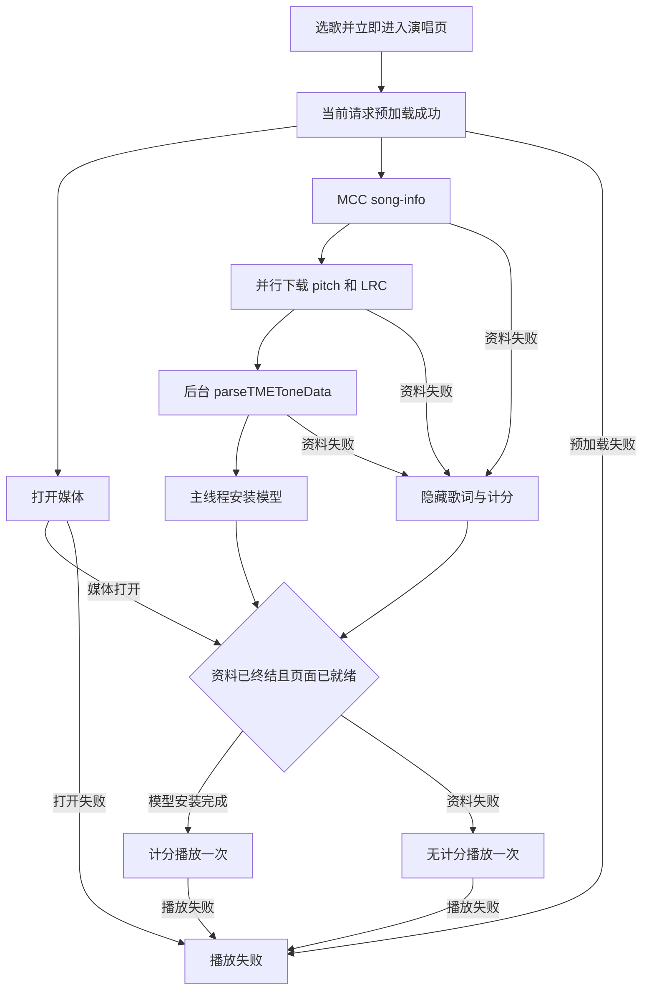

# Android TME Demo 计分接入设计

状态：用户已确认，进入实施。

参考：`LrcView-iOS/docs/superpowers/specs/2026-09-30-tme-demo-scoring-design.md`。Android 基线为 `dev/5.0`，提交 `3ada157`。

## 目标与范围

Android Demo 的 TME 模式提供选歌列表和独立演唱页。用户选择歌曲后立即进入演唱页，展示预加载、资料查询、两份资源的独立下载状态和播放状态。媒体打开且计分模型安装完成后开始内部逐句计分；计分资料失败时继续播放，隐藏整个歌词、音准和得分区域。预加载、打开媒体或播放失败属于播放错误，不能作为资料失败降级。

复用 `karaoke_view_ex` 中的 `TMEParser`、`TMERequestManager`、`KaraokeView.parseTMEToneData` 与内部计分。准备资料的可复用代码也放在公共组件中，随 AAR 发布；组件不引用 Demo、RTC/MCC SDK 类型或 Activity，不读取凭据，不创建或销毁 RTC/MCC/player。

`song-info` 通过已有 RTC engine 初始化的 MCC 调用 `sendExtRequest`，响应来自 MCC `onExtResponse`。HTTP 仅用于下载响应中的文件。MCC、MCC_EX 的原有 Demo 路径保留；本设计不改变计分算法、逐字时间、跳段回调或边界采样规则，不增加后台持续演唱、评分状态持久化或自动断点续唱。

## 当前实现与设计差异

| 当前 Android 行为 | 目标行为 |
| --- | --- |
| `MainActivity` 包含播放、资源下载和歌词显示；TME 用“下一首”切歌 | TME 模式显示可点击的选歌列表，选择后立即打开 `TmeSingingActivity` |
| `MccManager` 手工解析 `songs`，优先选 KRC，并保存列表中的歌词和 pitch URL | 列表使用独立请求管理器；演唱资料重新查询当前原始 songId 的 `song-info`，精确选择 LRC |
| `loadTmeLyrics` 顺序下载两份文件，读入内存 | 公共准备组件并行下载到会话独有目录，分别报告状态，实际取消网络任务 |
| `showTmeLyrics` 调用 `parseLyricData`，随后 `setLyricData(model, false)` | 后台调用 `parseTMEToneData(pitchPath, lyricPath)`，主线程安装模型并启用内部计分 |
| `onMusicOpenCompleted` 立即调用 `play()` | TME 增加播放门槛，媒体和资料两路终结后只启动一次 |
| 列表只有 pending 标记，预加载主要检查 songCode，UI 共用 `ServiceCallback` | 请求 ID、原始歌曲 ID、内部 songCode、歌曲会话身份分别关联；页面订阅分开 |
| 进度采用 20 ms 定时器，部分 tick 通过累加推算 | 保留 20 ms 更新节奏，TME 每次读取播放器实际位置，避免累计漂移 |

## 方案选择

| 方案 | 收益 | 代价 |
| --- | --- | --- |
| 公共资料准备组件 + 独立演唱页（推荐） | 可直接随组件发布，SDK 生命周期与 UI 解耦，资料链路可无凭证测试 | 新增准备组件、会话协调器和演唱页 |
| Demo 内资料辅助类 + 独立演唱页 | 公共库新增内容较少 | 接入方仍需复制下载、取消和请求关联代码 |
| 在 MainActivity 内追加完整流程 | 页面文件变化集中 | 下载、SDK 回调、播放门槛和生命周期继续集中在同一页面，复用需要拆出多段代码 |

采用第一种方案，沿用 XML 布局和 ViewBinding，不引入新的 UI 框架。

## 组件与文件职责

| 位置 | 职责 |
| --- | --- |
| `karaoke_view_ex/.../tme/TMEScoringPreparation.kt`（新增公开 API） | 请求 `song-info`，关联当前请求，选择匹配资源，并行下载，后台解析模型，报告阶段与终结结果 |
| `karaoke_view_ex/.../tme/TMEResourceDownloader.kt`（新增） | 可替换下载接口与默认实现，返回可取消任务；测试注入模拟下载器 |
| `karaoke_view_ex/.../tme/TMEScoringPreparationModels.kt`（新增公开类型） | 阶段、错误与成功结果；成功结果包含 `LyricModel` 和可计分句数 |
| `app/.../agora/tme/TmePlaybackController.kt`（新增） | 单曲会话状态、资料与媒体门槛、播放一次性控制、页面订阅和清理协调；SDK 操作通过小型适配接口注入 |
| `app/.../agora/MccManager.java`（调整） | 保留已有 MCC；关联列表、预加载与歌曲请求；管理 TME 单曲 player 与 observer，提供媒体事件，执行控制器决定的 SDK 操作 |
| `app/.../agora/ServiceManager.kt`（调整） | 持有当前 TME 控制器，分别转发列表和演唱事件，沿用已有 RTC/MCC 会话 |
| `app/.../MainActivity.java` 与 TME 列表布局（调整） | TME 模式展示歌曲列表和加载/失败/重试，按选择启动演唱会话；原有服务模式继续使用原页面 |
| `app/.../TmeSingingActivity.kt` 与 `activity_tme_singing.xml`（新增） | 歌曲信息、准备状态、播放控制、KaraokeView 与本句/累计/满分展示 |
| `app/src/main/AndroidManifest.xml`、`strings.xml`（调整） | 注册内部演唱页，提供用户可理解的状态及失败文案 |
| `app/TME_PARSER.md`、`karaoke_view_ex/TME_TONE_DATA.md`（更新） | 公开准备 API 及可复制的最小 MCC、进度、音高、评分接线示例，修正旧 Demo 状态描述 |

这里的 `...` 表示对应模块已有包路径。公共准备代码归 `io.agora.karaoke_view_ex.tme`；Demo 协调代码归 `io.agora.examples.karaoke_view_ex.agora.tme`。

## 公共资料准备接口

构造参数为调用方提供的缓存根目录 `File`；允许注入下载器与超时配置。准备组件在该根目录下创建自己拥有的会话子目录，不持有 Activity Context。内部使用独立的 `TMERequestManager`，并强持有解析委托，满足解析器弱引用委托的现有约定。

- `prepare(songId, sender)`：主线程调用；songId 为原始字符串，sender 使用已有 `TMERequestSender` 接口。开始前取消前一次准备。
- `handleExtResponse(requestId, jsonOption, httpCode, responseBody): Boolean`：主线程接收 MCC 原始四参数。属于当前准备请求时返回 true；重复响应被消费但不重复执行。其他请求返回 false，交由独立列表管理器处理。
- 阶段监听报告请求资料、歌词下载中/完成、pitch 下载中/完成、解析。UI 分别保存两份下载状态，不以最后收到的一条通知覆盖另一份状态。
- 成功通知包含 `LyricModel` 与 `scorableLineCount`。句数在库内读取本次解析得到的可计分结构，调用方无需引用内部模型；满分不能使用全部显示行数计算。
- 失败通知使用错误类别与必要的 HTTP/业务错误码，不返回可供 UI 直接显示的原始响应或异常正文。失败恰好通知一次。
- `cancel()`：主线程调用；使请求和排队回调失效，实际取消下载并清理本次文件，不发送成功或失败完成通知。
- `close()`：幂等终结当前准备、关闭自己创建的解析器及工作线程，释放监听；不关闭注入的共享下载器，不触碰 SDK 对象。使用 `Closeable` 保持库 API 17 下限。

为保持库的 minSdk 17，不将 Demo 已用的 OkHttp 4.12 加入公共库。默认下载实现使用 `HttpURLConnection` 和有界工作线程；任务取消会关闭流、断开连接，并取消工作任务。Demo 或业务可提供 OkHttp 下载适配器。网络、文件 I/O 和模型解析都不在主线程执行；对外通知回到主线程。

请求采用结构化 JSON API 构造：

```json
{"vendorId":2,"actionType":"song-info","actionParameter":{"songIdListStr":"原始 songId"}}
```

从 `TMEParser.onSongInfo` 返回的 songList 精确匹配 songId，读取非空 pitchUrl，并从 lrcList 选择 `type == "lrc"` 且 URL 非空的首项。不存在匹配歌曲、缺资源或只有 KRC 都属于资料失败；列表页已有的 URL 不作为本次计分资料的替代来源。

URL 必须为有主机名的 HTTP/HTTPS 地址，下载器接收原始字符串，不修改查询参数、签名、大小写或扩展名。网络访问遵守调用方的 Android 网络安全配置；Demo 不为本功能全局放开明文 HTTP，受策略拒绝时按下载失败降级。

## 选歌、播放门槛与状态

1. 用户点击列表条目，控制器创建 sessionId，保存原始 songId、名称和独立的内部 songCode，清除上次模型、得分及状态，立即导航到演唱页。Intent 仅传 sessionId 和歌曲身份，不传凭据、模型或 SDK 对象。
2. `getInternalSongCode` 与 `preload` 使用已有 MCC。保存预加载 requestId；仅匹配当前 requestId、songCode 和会话的完成事件可以继续。SDK 回调统一异步投递主线程，避免同步回调发生在发送函数返回、请求 ID 记录之前。
3. 预加载成功后，MccManager 为本次 TME 演唱创建独立 music player，注册捕获 sessionId 的 observer；然后并行启动 `player.open(songCode, 0)` 与准备组件的 `song-info` 流程。TME 的 open-completed 只设置 mediaOpened，不直接 play；非 TME 继续原播放路径。播放轨道与 RTC 的 mediaPlayerId 连接更新为本次 player。
4. MCC `onExtResponse` 先交给当前准备组件，再按请求 ID 交给独立的歌曲列表请求管理器，原始参数不改写。列表和资料不共用一个当前请求 ID。
5. 两个下载任务将文件流写入 `tme-scoring/<preparationId>/`，固定名称为 `song_pitch.json` 与 `song_lyric.lrc`。preparationId 是准备组件每次 prepare 独立生成的唯一 ID，与 Demo 的 sessionId 分开，组件不依赖调用方的会话命名。先写同目录临时文件，关闭流并验证完成后移动为目标文件；两份文件完成后后台调用 `KaraokeView.parseTMEToneData(pitchPath, lyricPath)`。
6. 模型成功后，主线程演唱页先执行 `setLyricData(model, true)`、显示计分区域，再确认该 session 的 modelApplied。媒体已打开、资料成功、页面模型已安装三者齐备，才允许第一次 play。
7. 资料失败则取消另一个下载、清除模型、隐藏计分区域；媒体打开且演唱页已接收无计分状态后可 play。资料失败后到达的成功回调不得重新打开计分区域。
8. playSubmitted 在调用 SDK play 之前置位，重复预加载、打开或准备回调不重复播放。SDK 返回失败或后续播放失败进入播放错误；仅收到 PLAYING 后启用持续进度与音高输入。pause/resume 是独立控制，不重新执行首次播放门槛。



状态快照包含 sessionId、歌曲信息、预加载进度、媒体状态、准备状态、歌词下载状态、pitch 下载状态、已准备的模型、是否启用计分、播放位置、本句分、累计分和满分。页面显示预加载、查询资料、两份下载状态、解析、等待媒体、计分播放、无计分播放、暂停、播放结束或播放失败。资料失败信息在无计分播放期间继续保留。相同页面实例只在该会话首次装载模型时调用 setLyricData；暂停、恢复及重复状态快照不得重新装载并重置评分器。

默认超时为：预加载 120 秒、打开媒体 30 秒、song-info 响应 30 秒、每份下载 60 秒、资料准备总计 120 秒、提交 play 后等待 PLAYING 15 秒。超时配置可替换，测试使用模拟时钟。准备超时属于可降级错误；预加载、媒体打开或播放启动超时属于播放错误。取消后所有超时任务失效。

## 页面与实时计分

演唱页顶部为返回、歌曲名称与演唱状态；准备区分别显示歌词与 pitch 的下载进度/完成情况。中部包含 ScoringView、LyricsView；得分区显示本句分、累计分和满分；底部显示播放进度、暂停/继续和原唱/伴奏控制。准备阶段歌词及得分容器隐藏，资料成功后显示；资料失败后全部隐藏，仍保留歌曲、原因与播放控制。

每 20 ms 的 TME 进度任务读取 `IAgoraMusicPlayer.getPlayPosition()`，不按定时器累加。RTC 沿用 `enableAudioVolumeIndication(50, 3, true)`，仅使用本地麦克风条目的 voicePitch；实际回调间隔由 Android 本地 SDK 决定，不把 iOS 头文件的 200 ms 下限直接当作 Android 契约，也不复制同一音高制造额外样本。

有效会话且处于计分播放时，主线程使用播放器实际位置先更新 `karaokeView.setProgress(positionMs)`，再调用 `karaokeView.setPitch((float) voicePitch, 0F, 0)`。内部计分忽略 setPitch 的时间参数，使用最近的歌词进度；因此对应采样前必须刷新位置，不能照搬当前外部计分路径的时间参数。进度轮询也持续更新显示；音高来源不是远端人声或伴奏。

`KaraokeEvent.onLineFinished` 更新本句 score、累计 cumulativeScore，并用回调 lineCount 校验准备结果中的可计分句数。满分为可计分句数乘 100；空行、署名、标题和无音高行不计入。初始得分为 0，准备阶段本句/累计显示 0，不在页面重新实现评分算法，也不把外部 onLineScore 混入 TME 内部得分。

暂停和无计分播放期间不向隐藏的组件提交音高或计分进度；无计分模式仍更新播放器进度显示。恢复时先更新真实位置再接收新音高。保留组件“自然播放完句子才回调”的既有行为，跳段不补回调，Demo 不伪造末句样本或最终得分。本次 TME 演唱页不新增跳过前奏、拖动 seek 或参数调节入口。

播放自然结束时按主线程事件顺序接收已经产生的逐句回调，随后停掉进度和音高输入，保留最终得分、禁用继续。用户主动停止或返回时结束本次演唱；重新演唱从新会话、位置 0 和得分 0 开始。

## Android 生命周期与异步安全

控制器由 ServiceManager 持有；列表和演唱分别订阅状态，不再由单一 ServiceCallback 在两页之间直接替换所有事件。SDK/下载的回调先进入控制器更新状态，再发给对应页面；UI listener 在 onStart/onStop 注册和解除。解除时校验 listener 身份，旧页面不能解除新页面的监听。列表 Activity 暂时进入后台不销毁 RTC/MCC/player，退出 TME 功能时才由原有管理层统一销毁。

常规旋转由演唱 Activity 的 `orientation|screenSize` 配置变化处理保留同一 KaraokeView 实例，布局适配新尺寸。确需销毁重建或进程被系统回收时，不尝试恢复组件未公开的逐音采样/评分快照：终止旧会话，显示“演唱已中断，重新开始”，用户重开后从头准备和计分。重建不得重复创建已存在的 RTC/MCC。

演唱页进入后台时暂停当前播放并停掉实时输入；已有页面实例的得分保留，回到前台由用户点击继续。准备中的页面进入后台不自动开始播放，首次播放门槛还要求页面处于可交互状态。准备可以继续，成功只保存状态；返回前台安装模型/显示降级状态后才启动。返回列表会取消当前准备、停止当前媒体、停止进度任务、解除演唱监听、reset KaraokeView，列表仍可选下一首。

每次选歌、退出或取消均递增会话代数；所有 SDK 响应、解析、下载、计时器和 UI 投递都检查会话代数及终结状态。preload 与 ext response 使用各自 requestId。播放器回调没有请求 ID，不能只看播放器状态来猜测所属歌曲：TME 每个歌曲会话使用独立 player/observer，旧 observer 捕获的 sessionId 随回调进入控制器，即使排队事件迟到也会丢弃。切歌前由 SDK 所有者 MccManager 停止、解除 observer、销毁旧 player，下一会话再创建自己的 player；只销毁本会话 player，不销毁仍供选歌使用的 RTC/MCC。可复制的准备组件和播放协调器不自行创建或销毁 SDK 对象。

准备组件 cancel 先使回调失效，再取消下载。只在本会话目录内写入；下载任务在取消与文件提交处检查身份，并在 finally 中清理自己的临时文件。关闭流/终止写入后再清理目录，避免工作线程重新生成已删除的文件；迟到任务只能清理它自己拥有的目录。清理失败记录本实例创建的待清理目录，在写任务全部终结后重试；不能按目录名前缀删除其他准备实例的活动会话，也不删除调用方缓存根目录或其他缓存。

MCC 无取消入口时只过滤旧请求，不销毁共享 SDK。终结结果在发送通知前消费，允许调用方在通知中开始下一首；通知重入后继续执行旧流程前必须再次检查会话身份。文件解析成功后可清理本次文件，因为返回模型已加载到内存。

日志仅保留阶段、错误类别、HTTP/业务错误码、资源是否存在和数量。现有 TME 路径中带 lyricUrl 的 SDK 日志需脱敏；禁止记录签名 URL、原始请求/响应正文、令牌和证书。失败文案不直接包含底层下载异常 message。

## 验证与验收

无凭证单元测试覆盖准备组件与播放控制器，SDK 适配接口、下载器、解析入口与超时调度可注入模拟实现。准备组件测试必须包含实际 TMEParser 的解码与 onSongInfo 接线；模拟模型解析不能替代库层真实文件解析和计分回归。

- 请求使用 vendorId 2、actionType song-info、原始 songIdListStr；特殊字符能正确 JSON 编码。多首结果只取当前 ID，列表资源不代替 song-info，type 为 LRC/krc 或缺 URL 时不被当成精确 lrc。
- 覆盖两份文件并行成功、HTTP/业务/结构错误、无匹配歌曲、非法 URL、空文件、下载/落盘失败、parseTMEToneData 返回 null；分别检查下载中/完成状态以及只回调一次。
- 覆盖媒体先完成、资料先完成、页面尚未就绪和重复 SDK 事件；计分模式验证安装模型早于 play，无计分模式验证隐藏区域早于 play，两种模式首次 play 均恰好一次。
- 资料失败取消另一下载，媒体成功后可无计分播放；预加载/open/play 失败、返回码失败、异步失败和对应超时均不进入正常播放。
- 列表与 song-info 并行不串请求；同歌重复准备、跨歌切换、取消、通知重入、close 后的 SDK/下载/解析/计时回调不更新新页面、不提交新文件、不调用 play。回调在发送函数内同步到达也能经主线程投递后正确关联。
- 使用带标题、空行、署名与无音高行的夹具核对满分；验证只收本地麦克风、progress 在 pitch 前更新、暂停/降级/结束后停止输入，并保留最后一句自然计分与跳段回归。
- 页面测试覆盖选歌立即跳转、独立下载状态、成功与降级容器可见性、暂停继续、返回、旋转和重建中断策略。只选 LRC 的规则不影响原 MCC/MCC_EX 的 XML/KRC 功能。
- 保留现有 31 项组件单元测试及主机 JNI 计分回归，新增公共准备组件和 Demo 控制器测试；测试资源放仓库内，不依赖仓库外歌词、凭据或真实下载地址。

验收以：公共组件 AAR 可构建、相关单元/主机测试通过，具备本地 RTC SDK 后 Demo APK 和页面 instrumentation 测试通过，具备有效凭据和手机后完成正常演唱、资料失败降级和返回切歌的真机验证为准。尚未满足后两个环境条件时，分别记录验证缺口，不宣称完整真机链路已验证。

## 构建与发布约束

dev/5.0 的 Demo 要求本地 `app/libs/agora-rtc-sdk.jar` 与 `app/src/main/jniLibs/arm64-v8a/libagora-rtc-sdk.so` 等配套库；实际签名、回调状态值和返回码以该套 Android SDK 为准，不用旧 Maven RTC 包替代新 SDK 进行 TME 端到端验证。凭据继续由被 Git 忽略的 local.properties 提供。

当前 Android 构建插件为 AGP 7.3.1，已验证构建使用缓存的 Gradle 8.7；wrapper 现有 Gradle 9 milestone 配置不兼容。本功能构建验证使用 Gradle 8.7，不修改既有 wrapper 变更或升级整个工具链；接入文档给出相应构建命令。公共准备 API 沿用库 minSdk 17 和 Kotlin 1.8；Demo 沿用 minSdk 21。库的源码/文档/测试可提交，SDK 二进制、凭据、APK 和临时资料不纳入提交。

源码方式通过现有 project 依赖引用公共准备 API；Maven 模式需等待包含该 API 的新组件版本发布，现有 3.0.4 不能直接使用新增入口。可复制示例仅展示传入 MCC 发送函数、转发原始四参数、安装模型、连接实时输入及 cancel/close，不要求复制 Demo 列表、ServiceManager、凭据文件或 SDK 创建销毁代码。
