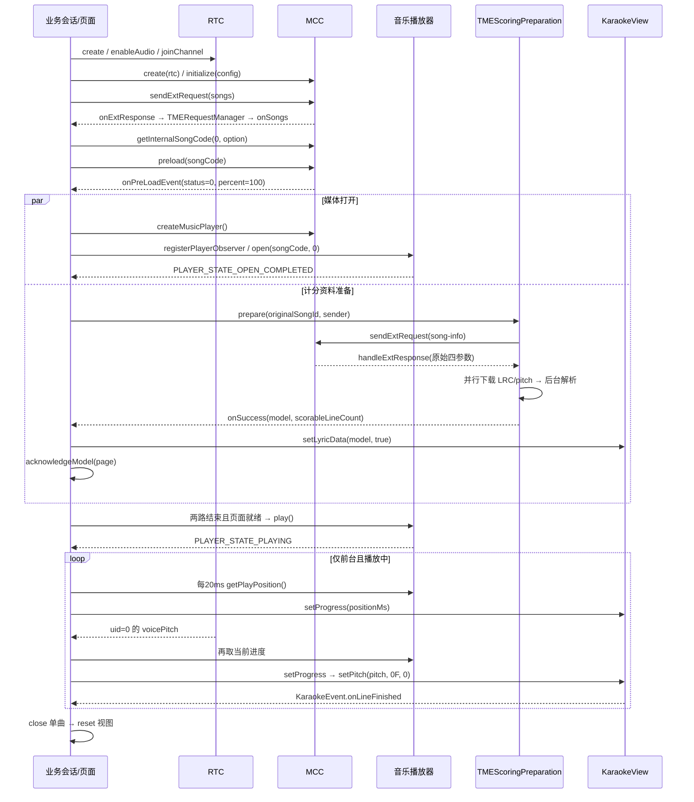

# Android TME 歌曲播放、歌词与内置打分接入参考

本文面向在自己的 Android 应用中接入 TME 选歌、播放、歌词、音高与逐句计分的开发者。按本文接入，可以实现本仓库 TME Demo 的完整流程，并自行设计页面。

接口依据：本仓库截至 2026-10-09 的源码及 `app/libs/agora-rtc-sdk.jar` 中的实际接口。结构参考 [iOS 接入文档](../../LrcView-iOS/docs/tme-ios-integration-guide.md)，代码及行为以 Android 实现为准。示例使用 Kotlin；除标为完整 XML 的示例外，代码是接入步骤片段，不是可直接运行的完整 Activity。片段中的 `mcc`、`player`、`karaoke` 等由同一个业务会话持有，页面展示函数由业务实现。

## 1. 接入结果与职责边界

完整流程：权限与凭据准备 → 创建 RTC 并入会 → 初始化绑定 RTC 的 MCC → 请求 TME 歌曲列表 → 将原始歌曲 ID 转换为内部 songCode → 预加载 → 并行打开播放器、准备歌词和音高 → 页面安装模型并确认就绪 → 播放 → 输入播放进度和本地音高 → 接收逐句分、累计分 → 退出和清理。

| 对象/组件 | 来源 | 职责 |
| --- | --- | --- |
| `RtcEngine` / `IRtcEngineEventHandler` | RTC SDK | 入会、采集麦克风、提供本地 `voicePitch` |
| `IAgoraMusicContentCenter` | RTC SDK | TME 请求、歌曲编号转换、预加载、创建播放器 |
| `IAgoraMusicPlayer` / `IMediaPlayerObserver` | RTC SDK | 打开、播放、暂停、恢复、读取媒体进度及播放状态 |
| `TMEParser` / `TMEParserDelegate` | 歌词库公开接口 | 解码 SDK 扩展回包，提供结构化结果 |
| `TMERequestManager` | 歌词库公开接口 | 管理一个当前请求，过滤旧请求和重复回包 |
| `TMEScoringPreparation` | 歌词库公开接口 | 查询 song-info，并行下载 LRC/pitch，解析计分模型 |
| `LyricsView` / `ScoringView` | 歌词库公开组件 | 分别展示歌词和音准条 |
| `KaraokeView` / `KaraokeEvent` | 歌词库公开接口 | 连接两个视图，输入时间/音高，执行内置计分并通知句分 |
| `TmePlaybackController` | Demo 业务代码 | 单曲状态、播放门控、超时、暂停和时间驱动 |
| `RtcManager` / `MccManager` / `ServiceManager` | Demo 业务代码 | 适配 SDK、转发回调、持有服务和单曲会话 |
| `KaraokeViewStyle`、共享 XML style | Demo 业务 UI | TME 与音集协共用的显示样式 |
| `LibrarySelectionActivity` / `MainActivity` / `TmeSingingActivity` | Demo 页面 | 曲库选择、TME 列表、独立演唱页 |

歌词库包名是 `io.agora.karaoke_view_ex`，TME 公共接口包名是 `io.agora.karaoke_view_ex.tme`。公共准备组件不创建、销毁或控制 RTC/MCC/player，也不生成 token。已有 RTC/MCC 的应用可直接接入第 5～10 节；不必复制 Demo 管理器。需要复用 Demo 的完整单曲状态机时，参考第 8 节，它位于 app 模块，不在歌词 AAR 内。

## 2. 依赖、账号与权限

### 2.1 引入 SDK 和歌词库

当前 Demo 使用同一份 SDK 配套的 Java jar 和原生库：

```text
app/
  libs/agora-rtc-sdk.jar
  src/main/jniLibs/arm64-v8a/
    libagora-rtc-sdk.so
    ...该 SDK 提供的其他原生库
```

将交付 SDK 的 jar 与目标 ABI 下的整组 `.so` 一起引入，不混用其他版本的 JNI。当前 Demo 的 `abiFilters` 仅包含 `arm64-v8a`；需要其他设备架构时，增加对应 ABI 和它的配套库。歌词库 AAR 自身也包含内置计分所需的 native 库。

本仓库 app 的依赖配置摘录：

```groovy
dependencies {
    api fileTree(dir: 'libs', include: ['*.jar', '*.aar'])
    implementation project(':karaoke_view_ex')
    implementation('io.github.winskyan:Agora-MccExService:2.2.0.133.8') {
        exclude(group: 'io.agora.rtc', module: 'agora-special-full')
    }
}
```

`Agora-MccExService` 是 Demo 兼容其他服务使用的依赖；只接入 TME 时不必引入它。工程已有其他依赖间接引入 RTC 时，应避免重复打包另一份 RTC。源码接入保持 `gradle.properties` 的 `isSdkMode=false`。也可使用由当前源码构建的歌词 AAR，连同其传递依赖接入；不要把 AAR 当成包含所有依赖的独立包。

现有 Maven `io.github.winskyan:Agora-LyricsViewEx:3.0.4` 尚不含本次新增的 TME 接口。仓库的 `sdkVersion=3.0.4` 不能说明远端同名包具有这些 API。引入发布版本前检查是否实际包含 `TMERequestManager`、`TMEScoringPreparation` 和 `KaraokeView.parseTMEToneData`。

当前工程：AGP 7.3.1、Kotlin 1.8.0、Java/Kotlin 目标 1.8、compile/target SDK 34；Demo minSdk 21，歌词库 minSdk 17。歌词库的最低版本不代表配套 RTC SDK 支持同样的最低版本。源码构建另需 NDK `28.2.13676358` 和 CMake `3.22.1`。验证此仓库使用 Gradle 8.7；当前 wrapper 的 Gradle 9 milestone 与 AGP 7.3.1 不兼容。

### 2.2 账号和环境

| 配置 | 用途 |
| --- | --- |
| RTC App ID、RTC token | 创建 RTC、加入指定 channel；token 与 App ID/channel/uid 匹配 |
| RTC uid、channel | 麦克风采集和媒体音轨发布所用会话 |
| MCC App ID、MCC token、mccUid | 初始化 MCC；账号需要 TME 曲库访问权限，token 与用户匹配 |
| MCC domain | 该账号对应的服务环境；本次 Demo 测试使用 `api-test.agora.io` |

Demo 在 `local.properties` 配置 `APP_ID`、`APP_CERTIFICATE`、`TME_MCC_DOMAIN`，由 [app/build.gradle](../app/build.gradle) 注入 `BuildConfig`。Android 的 [KeyCenter](../app/src/main/java/io/agora/examples/utils/KeyCenter.java) 使用 RTC token 和旧版 RTM token builder 在本地生成调试 token，MCC 使用 `getRtmToken(uid)`。这一点与 iOS Demo 的 token2 路径不同。业务 App 使用自己的服务端下发 token，App Certificate 留在服务端；更新 MCC token 的接口是 `mcc.renewToken(newToken)`。

`TME_MCC_DOMAIN` 为空时 Demo 不设置 `config.mccDomain`。此前列表失败的实测原因是进入默认 `api.agora.io` 环境后收到 HTTP 404；配置账号对应的 `api-test.agora.io` 后恢复。测试域名不能作为所有应用的固定值，生产接入使用服务方分配的环境。

### 2.3 权限与网络

最小 Manifest 声明示例：

```xml
<manifest xmlns:android="http://schemas.android.com/apk/res/android">
    <uses-permission android:name="android.permission.INTERNET" />
    <uses-permission android:name="android.permission.ACCESS_NETWORK_STATE" />
    <uses-permission android:name="android.permission.RECORD_AUDIO" />
    <application />
</manifest>
```

采集前按 Android 版本申请 `RECORD_AUDIO` 运行时权限，并处理拒绝、返回页面及退出后迟到的授权结果。公共准备组件写入 `applicationContext.cacheDir`，该流程不需要存储权限；Demo Manifest 中的旧存储权限用于其他既有功能。

签名资源 URL 必须原样传给下载器，不替换协议、不重排签名参数。默认下载器支持 HTTP(S)，但受应用的 Android 网络安全策略约束；Demo 没有全局放开明文 HTTP。如服务返回 HTTP，先与服务方确认可用资源及所需域名策略。

## 3. 总体调用时序



资料失败分支：隐藏歌词、音准与分数区域 → `acknowledgeUnscored(page)` → 媒体打开后允许无计分播放。预加载或媒体失败直接结束单曲。Android 当前 Demo 在创建 RTC 并调用 join 后即初始化 MCC，`onJoinChannelSuccess` 不承载 MCC 初始化；不要照搬 iOS 的“入会回调里初始化 MCC”作为 Android 当前实现的描述。业务应另行处理 RTC 初始化/入会的返回码和失败状态。

## 4. 初始化 RTC 和 MCC

以下变量由业务凭据层提供：`context`、`appId`、`uid: Int`、`channel: String`、`rtcToken`、`mccToken`、`mccDomain`。`rtcHandler` 是业务持有的 `IRtcEngineEventHandler`，实时音高处理见第 9 节。

```kotlin
import io.agora.rtc2.ChannelMediaOptions
import io.agora.rtc2.Constants
import io.agora.rtc2.RtcEngine
import io.agora.rtc2.RtcEngineConfig
import io.agora.musiccontentcenter.IAgoraMusicContentCenter
import io.agora.musiccontentcenter.MusicContentCenterConfiguration

val rtc = RtcEngine.create(RtcEngineConfig().apply {
    mContext = context.applicationContext
    mAppId = appId
    mChannelProfile = Constants.CHANNEL_PROFILE_LIVE_BROADCASTING
    mAudioScenario = Constants.AUDIO_SCENARIO_CHORUS
    mEventHandler = rtcHandler
})
check(rtc.enableAudio() == 0)
check(rtc.enableAudioVolumeIndication(50, 3, true) == 0)
check(rtc.joinChannel(rtcToken, channel, uid, ChannelMediaOptions().apply {
    publishMicrophoneTrack = true
    autoSubscribeAudio = true
    clientRoleType = Constants.CLIENT_ROLE_BROADCASTER
}) == 0)

val mcc = IAgoraMusicContentCenter.create(rtc)
val config = MusicContentCenterConfiguration().apply {
    this.appId = appId
    mccUid = uid.toLong()
    token = mccToken
    eventHandler = mccHandler
    if (mccDomain.isNotBlank()) this.mccDomain = mccDomain
}
check(mcc.initialize(config) == 0)
```

`check` 用于突出成功条件；应用将非 0 返回码和异常转为可恢复的错误页面，并释放已创建对象。`joinChannel` 返回 0 只表示提交成功，入会结果仍由 RTC 回调确认。`enableAudioVolumeIndication(50, 3, true)` 的第三参数启用相关语音检测能力，Demo 使用 50ms 回调间隔。

`mccHandler` 类型为 `IMusicContentCenterEventHandler`，实际 SDK 要求实现全部六个方法。下面四个未用于当前 TME 链路的方法可空实现；两个主要方法的路由见第 5、6 节：

| 回调签名（Java 参数类型） | 本流程处理 |
| --- | --- |
| `onExtResponse(String requestId, String jsonOption, int httpCode, String response)` | 主线程路由至资料准备或列表请求管理器 |
| `onPreLoadEvent(String requestId, long songCode, int percent, String lyricUrl, int status, int errorCode)` | 主线程匹配单曲预加载；不直接调用 play |
| `onMusicCollectionResult(String requestId, int page, int pageSize, int total, Music[] music, int errorCode)` | 当前 TME 不使用 |
| `onMusicChartsResult(String requestId, MusicChartInfo[] charts, int errorCode)` | 当前 TME 不使用 |
| `onLyricResult(String requestId, long songCode, String lyricUrl, int errorCode)` | 当前 TME 使用 song-info 准备资料，不使用它 |
| `onSongSimpleInfoResult(String requestId, long songCode, String simpleInfo, int errorCode)` | 当前 TME 不使用 |

将回调与会话的创建代次关联。所有 SDK 回调转主线程后，再检查会话是否已经关闭、是否仍为当前会话。SDK 可能在发送函数返回 requestId 前同步回调；Demo 始终用 `Handler.post` 延后处理，确保关联 ID 已保存。

## 5. 请求 TME 歌曲列表与回包路由

### 5.1 构造列表请求

```json
{
  "vendorId": 2,
  "actionType": "songs",
  "actionParameter": { "queryInfo": "", "limit": 20 }
}
```

`vendorId` 对应 `IAgoraMusicContentCenter.MUSIC_CONTENT_CENTER_VENDOR_ID_TME`。`queryInfo=""` 请求首页；组件保留 `nextQueryInfo`，需要翻页时根据服务的分页契约发送下一请求。Demo 只取首页。保留 `songId` 的原始字符串，包括前导零；不要提前转成数字。

```kotlin
import io.agora.karaoke_view_ex.tme.*

// 这些对象是业务会话的字段；delegate 必须被强持有。
val listRequests = TMERequestManager { option -> mcc.sendExtRequest(option) }
val listDelegate = object : TMEParserDelegate {
    override fun onSongs(requestId: String, result: TMESongsResult) {
        val visible = result.songList.filter {
            it.songId.isNotEmpty() &&
                (it.status == null || it.status == 1) &&
                (it.grantStatus == null || it.grantStatus == 1)
        }.take(20)
        // 主线程：结束 loading；空列表与错误状态分别展示。
        // 页面保存 visible 的 songId/songName，并在点击时创建单曲会话。
    }
    override fun onParseError(
        requestId: String, jsonOption: String, responseBody: String, error: TMEParseError
    ) {
        // 主线程：结束 loading，按 HttpError/BusinessError 等展示可重试状态。
    }
}
listRequests.delegate = listDelegate
val requestId = listRequests.sendRequest(
    """{"vendorId":2,"actionType":"songs","actionParameter":{"queryInfo":"","limit":20}}"""
)
if (requestId == null) {
    // SDK 未接受请求：立即结束 loading，显示发送失败。
}
```

过滤可用状态、最多显示 20 首是 Demo 策略，解析器返回完整列表。`status` / `grantStatus` 缺失时 Demo 允许展示，提供且不等于 1 时跳过。业务另行确认可用范围及授权条件。

### 5.2 路由 onExtResponse

每个独立请求流使用独立 `TMERequestManager`；管理器只有一个当前 requestId。计分准备组件内部已经持有自己的管理器，不要让列表管理器发 song-info 而覆盖列表请求。

下面是 `mccHandler.onExtResponse` 的方法体片段，`preparation` 是当前单曲的可空准备组件，`main` 是主线程 Handler，`closed` 表示拥有 MCC 的业务会话已退出：

```kotlin
main.post {
    if (!closed) {
        val consumed = preparation?.handleExtResponse(
            requestId, jsonOption, httpCode, response
        ) ?: false
        if (!consumed) {
            listRequests.onExtResponse(requestId, jsonOption, httpCode, response)
        }
    }
}
```

四参数使用 SDK 原值，不自行拆解 `response` 或改造 `jsonOption`。`handleExtResponse` 返回 true 表示当前资料流程已消费，包括该请求的重复/终结后回包；false 表示交给其他流程。列表管理器在交付阶段过滤其他 requestId；实际 Demo 还先比对当前列表 ID，以减少无关解析。

`TMERequestManager.sendRequest/stop/close/delegate` 设置必须在主线程，`onExtResponse` 本身允许任意线程调用。直接使用 `TMEParser.parse(...)` 也可解码，但解析器不会负责当前请求和页面生命周期过滤。两者都弱引用 delegate，调用方需持有 delegate 字段。Java 可继承 `TMEParserAdapter`，只重写所需回调。

### 5.3 可用响应 API

| actionType | 成功回调 | 模型 |
| --- | --- | --- |
| `songs` | `onSongs` | `TMESongsResult(songList, nextQueryInfo)` |
| `search-song` | `onSearchSongs` | `TMESearchSongsResult(total, songList)` |
| `song-info` | `onSongInfo` | `TMESongInfoResult(songList)` |
| `song-url` | `onSongUrl` | `TMESongUrlResult(mediaList)` |
| `songlist-page` / `ranklist-page` | `onSonglistPage` / `onRanklistPage` | `TMEPageResult` |
| `songlist-detail` / `ranklist-detail` | `onSonglistDetail` / `onRanklistDetail` | `TMEDetailResult` |

本演唱链路直接发 songs，由准备组件发 song-info，媒体交给 SDK 的编号转换和预加载；不需要额外发 song-url 再自行播放 HTTP URL。上表表示解析器支持的响应操作，其余操作的完整请求参数应按配套服务契约构造，不能由响应模型推断。详见 [响应解析说明](../app/TME_PARSER.md)。

## 6. 歌曲编号转换与预加载

选歌得到 `originalSongId: String` 后创建唯一 sessionId；整个单曲过程中保持原始 ID 不变。

```kotlin
import org.json.JSONObject

val conversionOption = JSONObject().apply {
    put("vendorId", IAgoraMusicContentCenter.MUSIC_CONTENT_CENTER_VENDOR_ID_TME)
    put("actionParameter", JSONObject().apply {
        put("songCode", originalSongId)  // 此处参数名是 songCode，值仍是原始字符串 ID
        put("fileType", "mkv")
    })
}.toString()
val internalSongCode = mcc.getInternalSongCode(0L, conversionOption)
check(internalSongCode > 0L)
val preloadRequestId = mcc.preload(internalSongCode)
check(!preloadRequestId.isNullOrEmpty())
```

编号转换请求没有 `actionType`，不送入 TME 响应解析器。`getInternalSongCode` 返回的 long 是 SDK 内部编号，只用于 `preload/open`，不是 song-info 的字符串 ID。`preload(long)` 返回字符串 requestId；另一个 `preload(long, String)` 重载返回 int，不能当成请求 ID 使用。

回调由主线程处理，并同时核对当前 sessionId、preloadRequestId 和 internalSongCode。Demo 对这组 SDK 的判断是：

| onPreLoadEvent 条件 | 行为 |
| --- | --- |
| `status == 1` 或 `errorCode != 0` | 单曲播放失败，不开始资料准备或播放 |
| `status == 0 && percent == 100` | 消费一次完成，开始打开媒体和资料准备 |
| 其他状态/百分比 | 更新预加载进度，继续等待或由超时结束 |

保留 SDK 的 status/errorCode，用于诊断；界面百分比可约束到 0～100。不要仅看到 100% 就忽略 status，也不要用这个回调的 lyricUrl 代替后面的 song-info。完成通知可能重复，只有第一次进入打开媒体流程。

## 7. 准备歌词和音高模型

### 7.1 推荐公共入口：TMEScoringPreparation

```kotlin
import io.agora.karaoke_view_ex.tme.*

val preparation = TMEScoringPreparation(context.applicationContext.cacheDir)
preparation.listener = object : TMEScoringPreparationListener {
    override fun onStage(stage: TMEScoringPreparationStage) {
        // 分别更新歌词与 pitch 下载状态，不把两者合成一个下载百分比。
    }
    override fun onSuccess(result: TMEScoringPreparationResult) {
        // 主线程。自行实现门控时，先装模型，再标记 pageReady。
        karaoke.setLyricData(result.lyricModel, true)
        // 显示计分区域；保存 fullScore = result.scorableLineCount * 100。
        // 与 mediaOpened 汇合后才可 play，见第 8 节。
    }
    override fun onFailure(error: TMEScoringPreparationError) {
        // 隐藏歌词、音准、分数整个区域，再标记“允许无计分播放”。
        // 播放器是否可播放仍取决于媒体打开状态。
    }
}
preparation.prepare(originalSongId, TMERequestSender { option ->
    mcc.sendExtRequest(option)
})
```

上例用于自己实现播放门控。使用 Demo `TmePlaybackController` 时，准备回调只通过端口交给控制器，页面从 `onState` 安装模型并 acknowledge，不能同时再用上例直接触发播放。

准备组件自动发送：

```json
{
  "vendorId": 2,
  "actionType": "song-info",
  "actionParameter": { "songIdListStr": "<原始 songId 字符串>" }
}
```

处理规则与约束：

1. 从 `songList` 选择 `songId == originalSongId` 的条目。
2. 选择该条目的第一个精确 `type == "lrc"` 且 URL 非空的 `lrcList` 项，以及非空 `pitchUrl`。不使用 KRC、列表缓存或 HTTP/HTTPS 优先级替换。
3. 校验 URL，创建 `cacheDir/tme-scoring/<UUID>/`，并行下载 `song_lyric.lrc` 与 `song_pitch.json`。
4. 两份文件校验完成后，后台调用 `KaraokeView.parseTMEToneData(pitchPath, lyricPath)`。
5. 主线程返回 `TMEScoringPreparationResult(lyricModel, scorableLineCount)`；模型已在内存，之后清理该准备实例创建的临时文件。

入口、listener 设置、`handleExtResponse`、`cancel`、`close` 都必须在主线程；网络、文件、模型解析在后台。再次 prepare 会取消前一次；cancel 不发完成回调；close 幂等，关闭后不能 prepare。成功/失败只终结一次，旧会话不能更新新歌。

### 7.2 进度、超时与自定义下载器

阶段为 `QUERYING`、`LYRIC_DOWNLOADING`、`LYRIC_DOWNLOADED`、`PITCH_DOWNLOADING`、`PITCH_DOWNLOADED`、`PARSING`。两份资源并行下载，完成顺序不固定，分别保存各自状态。

默认超时：song-info 查询 30 秒、每份资源下载 60 秒、整个准备流程 120 秒。可配置：

```kotlin
val preparation = TMEScoringPreparation(
    cacheRoot = context.cacheDir,
    timeouts = TMEScoringPreparationTimeouts(
        queryMs = 30_000L, downloadMs = 60_000L, overallMs = 120_000L
    )
)
```

可注入 `TMEResourceDownloader`，其公开签名为：

```kotlin
fun download(
    url: String,
    destination: java.io.File,
    callback: (TMEResourceDownloadResult) -> Unit
): TMEResourceDownloadTask
```

实现必须在写入停止后恰好回调一次，包括取消；返回任务提供 `cancel()`。默认 `TMEHttpResourceDownloader` 流式写临时文件后重命名，连接/读取各限 30 秒。注入的下载器由调用方持有和关闭，preparation.close 不关闭共享下载器。详细契约见 [音高与准备组件说明](../karaoke_view_ex/TME_TONE_DATA.md)。

### 7.3 已有本地文件时

```kotlin
// 后台线程执行；顺序是 pitch JSON 在前，LRC 在后。
val model = KaraokeView.parseTMEToneData(pitchFile.absolutePath, lrcFile.absolutePath)
// 回主线程，仍核对当前单曲代次：
if (model != null) karaoke.setLyricData(model, true)
```

该同步 API 不请求网络。无合法时间行、无可计分音符、文件不可读或格式错误时返回 null。TME pitch 的 `st/d` 单位毫秒，`p` 是资源音高编码；模型解析器会换算成频率。麦克风输入使用 RTC `voicePitch`，不把资源的 `p` 直接传给 `setPitch`。

## 8. 打开媒体和播放门控

### 8.1 SDK 调用与状态映射

预加载完成后创建当前单曲的 player 和 observer。observer 必须捕获创建它时的 sessionId，不能在回调时把旧事件绑定到新 sessionId。

```kotlin
val player = mcc.createMusicPlayer()
check(player != null)
check(player.registerPlayerObserver(playerObserver) == 0)
check(rtc.updateChannelMediaOptions(ChannelMediaOptions().apply {
    publishMediaPlayerAudioTrack = true
    publishMediaPlayerId = player.mediaPlayerId
}) == 0)
check(player.open(internalSongCode, 0L) == 0)
// 并行调用 preparation.prepare(originalSongId, sender)。
```

`open` 返回 0 只是接受请求，等待 `onPlayerStateChanged`。`IMediaPlayerObserver` 是接口，除主要回调外，其余方法也需实现；可直接参照 [MccManager 的完整 observer](../app/src/main/java/io/agora/examples/karaoke_view_ex/agora/MccManager.java)。不要把不完整的匿名对象当作完整实现。

| SDK MediaPlayerState | Demo PlayerEvent | 控制器行为 |
| --- | --- | --- |
| `PLAYER_STATE_OPEN_COMPLETED` | `OPENED` | 标记媒体打开，尝试汇合条件 |
| `PLAYER_STATE_PLAYING` | `PLAYING` | 确认播放，开启进度/pitch 输入 |
| `PLAYER_STATE_PAUSED` | `PAUSED` | 停止进度驱动 |
| `PLAYER_STATE_PLAYBACK_ALL_LOOPS_COMPLETED` | `COMPLETED` | 停止驱动，保留页面结果 |
| `PLAYER_STATE_FAILED` | `FAILED` | 终结播放流程并释放媒体 |

### 8.2 四个条件全部满足才播放

首次 `player.play()` 的条件是：媒体已打开、资料成功或明确失败、演唱页已附着、页面已安装模型或隐藏计分区域并确认。资料成功时仅收到模型还不算页面就绪。首次 play 只提交一次；SDK 确认 PLAYING 前不提交评分输入。

自行实现门控时，核心逻辑可按下面组织。`mediaOpened`、`preparationFinished`、`pageAttached`、`pageApplied`、`playSubmitted`、`closed` 是单曲字段，初始均为 false；所有修改和调用均在主线程。`onPlaybackFailure` 是业务终结单曲、显示错误并释放资源的函数：

```kotlin
fun tryStartPlayback() {
    if (closed || playSubmitted || !mediaOpened || !preparationFinished ||
        !pageAttached || !pageApplied) return
    // 先消费播放资格，防止 SDK 同步回调或页面重入重复 play。
    playSubmitted = true
    val result = player.play()
    if (result != 0) onPlaybackFailure("PLAY_REJECTED:$result")
}
```

收到 OPEN_COMPLETED 后设置 mediaOpened 并调用该函数；资料成功时先安装模型和显示区域，再设置 preparationFinished/pageApplied 并调用；资料失败时先隐藏区域，再设置同样两个条件并调用。页面尚未附着时，资料回调只保存准备结果并设置 preparationFinished，不能替尚不存在的 View 确认 pageApplied。

页面进入时设置 pageAttached=true；若是新 View，先清除 pageApplied，再根据保存的结果安装模型或隐藏计分区域，确认后设置 pageApplied=true 并再次调用 tryStartPlayback。这样媒体和资料先于页面就绪时也能开始播放。退出时设置 pageAttached=false，已开始播放的会话退后台应暂停。这段只展示首次播放资格，仍需实现超时、异步 PLAYING 确认、暂停/继续与旧会话过滤；下面的控制器已包含这些逻辑。

业务可以实现这些状态，也可参考/移植 [TmePlaybackController](../app/src/main/java/io/agora/examples/karaoke_view_ex/agora/tme/TmePlaybackController.kt)。它是 Kotlin 单曲业务类，未随歌词 AAR 发布。全部调用及端口回调由拥有者串行化到 UI 线程：

| 接口 | 需要适配到的 API |
| --- | --- |
| `MediaPort.preload(sessionId, songId)` | 编号转换 + `mcc.preload`，返回 `PreloadRequest(songCode, requestId)` |
| `MediaPort.open(sessionId, songCode)` | 创建 player/observer、发布音轨、`player.open` |
| `MediaPort.play/pause/resume()` | 同名 player 方法，返回 SDK 状态码 |
| `MediaPort.position()` | `player.getPlayPosition()`，毫秒 |
| `MediaPort.release()` | 取消媒体音轨发布，注销 observer，stop/destroy player；幂等 |
| `PreparationPort.start(songId, listener)` | 设置准备 listener，prepare；阶段映射到 `Stage`，结果交给 `onReady(model, count)` |
| `PreparationPort.cancel()` | preparation.cancel；拥有者结束后还要 preparation.close |
| `Scheduler.schedule(delayMs, action)` | Handler.postDelayed；返回可 removeCallbacks 的 Cancel |

端口返回失败码而不抛出异常；媒体适配层捕获 SDK 异常并返回失败，由控制器统一处理。完整可参考 [ServiceManager.startTmeSong](../app/src/main/java/io/agora/examples/karaoke_view_ex/agora/ServiceManager.kt)。

### 8.3 复用现有 Demo 流程

在已由 MainActivity 初始化 TME 服务的前提下：

```kotlin
val sessionId = ServiceManager.startTmeSong(context, song.songId, song.name)
if (sessionId != null) {
    val controller = ServiceManager.getTmeController(sessionId)
    // 启动演唱页时携带 sessionId/songId/songName；onStart 里 attach 页面 listener。
}
```

页面实现 `TmePlaybackController.Listener<LyricModel>`，收到状态时：

```kotlin
override fun onState(state: TmePlaybackController.State<LyricModel>) {
    if (state.sessionId != sessionId) return
    val current = controller ?: return
    if (state.scoring && state.model != null) {
        if (installedModel !== state.model) {
            karaoke.setLyricData(state.model, true)
            installedModel = state.model
        }
        scoringArea.visibility = android.view.View.VISIBLE
        if (foreground) current.acknowledgeModel(this)
    } else {
        scoringArea.visibility = android.view.View.GONE
        if (installedModel != null) {
            karaoke.reset()
            installedModel = null
        }
        if (foreground && state.preparationError != null) {
            current.acknowledgeUnscored(this)
        }
    }
    // 状态标签、下载状态、句分/累计分/满分同样由 state 更新。
}
```

`installedModel: LyricModel?`、`foreground`、`sessionId`、`controller` 为页面字段。不要每次状态通知重复 `setLyricData`，它会重新初始化计分。attach 会要求新页面重新确认自己的 View，acknowledge 只能由当前 listener 调用。控制器 `start()` 在单曲中只执行一次，Demo 延后到主线程调用；不要在每次 onStart 重新开始预加载。

## 9. 歌词进度、实时音高与逐句计分

### 9.1 连接显示组件

```kotlin
import io.agora.karaoke_view_ex.KaraokeView

val karaoke = KaraokeView(lyricsView, scoringView)
lyricsView.enableDragging(false)
// 模型准备成功，先 setLyricData(model, true)，再允许播放。
```

`LyricsView`、`ScoringView` 是实际 Android View；`KaraokeView` 是协调对象，不是用来直接放入 XML 的布局 View。内部计分必须用 `setLyricData(model, true)`，无需外部服务的 onLineScore。

### 9.2 使用播放器毫秒位置

TME 控制器每 20ms 读取实际 `player.getPlayPosition()`，不是本地递增估算。页面的两个 listener 方法与 Demo 一致：

```kotlin
override fun onPosition(positionMs: Long, scoring: Boolean) {
    if (scoring) karaoke.setProgress(positionMs)
}
override fun onPitch(pitch: Double) {
    karaoke.setPitch(pitch.toFloat(), 0F, 0)
}
```

RTC Handler 的 `onAudioVolumeIndication` 只取 `uid == 0` 的本地演唱者 `voicePitch`。Demo 在 RTC 回调里调用 `ServiceManager.updateSpeakerPitch(voicePitch)`，由管理器把捕获的当前控制器转发到主线程并检查仍是当前会话。自建会话也要做同样的检查。

下面是业务已有 `IRtcEngineEventHandler` 中的方法；`controller` 为可空的当前单曲字段，`main` 是主线程 Handler：

```kotlin
override fun onAudioVolumeIndication(
    speakers: Array<out IRtcEngineEventHandler.AudioVolumeInfo>?, totalVolume: Int
) {
    val pitch = speakers?.firstOrNull { it.uid == 0 }?.voicePitch ?: return
    val captured = controller ?: return
    main.post {
        if (controller === captured) captured.onLocalPitch(pitch)
    }
}
```

使用此片段需导入 `io.agora.rtc2.IRtcEngineEventHandler`。复用 Demo 时让 `ServiceManager.updateSpeakerPitch` 做转发即可，不再重复提交同一采样。

控制器收到有效 pitch 后再次读取播放器位置，先 `onPosition` 后 `onPitch`。内部计分模式使用此前 setProgress 的时间，因此 `setPitch` 第二参数为 0F、第三参数为 0；不向组件传自算 pitchScore。Android TME 当前没有 iOS 的 250ms 进度偏移。

仅在页面就绪、前台附着、PLAYER_STATE_PLAYING 且计分资料成功时输入评分。pause、未打开、未安装模型、取消/失败/完成均停止输入。真实 `voicePitch == 0` 表示静音，仍转交，负数/非有限值过滤；不要因为静音而忽略真实回调，也不要伪造末尾采样来强行触发得分。

### 9.3 接收句分、累计分与满分

```kotlin
import io.agora.karaoke_view_ex.KaraokeEvent
import io.agora.karaoke_view_ex.internal.model.LyricsLineModel

karaoke.setKaraokeEvent(object : KaraokeEvent {
    override fun onDragTo(view: KaraokeView, progress: Long) {
        // 本 TME 流程禁用拖动，无需 seek。
    }
    override fun onLineFinished(
        view: KaraokeView, line: LyricsLineModel, score: Int,
        cumulativeScore: Int, index: Int, lineCount: Int
    ) {
        controller?.onLineFinished(score, cumulativeScore, lineCount)
        // 不复用 Demo 控制器时：更新业务句分/累计分，并核对准备返回的句数。
    }
})
```

`index` 是可计分句从 0 开始的索引，`lineCount` 是可计分句总数；`line` 对应原显示行。标题、词曲署名、空行和无音高行仍可显示，但不计零分，也不加入评分分母。满分取 `result.scorableLineCount * 100`，不是全部 LRC 显示行数。

TME 模型的内置规则：先平均每个音符的采样分，再平均整句音符分；未采样音符得 0。累计分取回调值（含组件已有 initialScore 机制），不要另加一次句分。句边界先结算前句，再把当前采样交给新音符。控制器会通过 `scoreLineCountMatches` 暴露回调句数与准备结果是否一致。

歌词进度更新负责显示和当前计分时间；自然句结算由真实音高输入驱动，媒体完成回调不会额外生成一笔末句分。自建线程模型时，把组件输入及业务得分处理统一串行到主线程，避免在 SDK 后台回调直接操作 View。

## 10. 沿用音集协的歌词/计分 UI

Demo 两条曲库链路使用同一份 [karaoke_styles.xml](../app/src/main/res/values/karaoke_styles.xml) 和 [KaraokeViewStyle](../app/src/main/java/io/agora/examples/karaoke_view_ex/KaraokeViewStyle.java)。TME 演唱页的组件区域铺满可用宽度，上下排列：120dp 音准区域、20dp 间隔、200dp 歌词区域、分数摘要。

下面是完整的组件区域 XML。复用 Demo 工程时可以使用现成 style；独立应用需要复制 style 中的属性及引用颜色，或定义自己的等效样式：

```xml
<LinearLayout xmlns:android="http://schemas.android.com/apk/res/android"
    android:id="@+id/scoring_area"
    android:layout_width="match_parent"
    android:layout_height="wrap_content"
    android:orientation="vertical"
    android:visibility="gone">
    <io.agora.karaoke_view_ex.ScoringView
        android:id="@+id/scoring_view"
        style="@style/KaraokeScoringView" />
    <io.agora.karaoke_view_ex.LyricsView
        android:id="@+id/lyrics_view"
        style="@style/KaraokeLyricsView" />
    <TextView android:id="@+id/score_summary"
        android:layout_width="match_parent"
        android:layout_height="wrap_content"
        android:layout_marginStart="2dp" />
</LinearLayout>
```

初始化时 Demo 调用：

```kotlin
KaraokeViewStyle.apply(context, lyricsView, scoringView)
val karaoke = KaraokeView(lyricsView, scoringView)
lyricsView.enableDragging(false)
```

共享 XML 默认音准背景为 `holo_orange_light`，歌词背景为 `purple_200`；音准移动速度 0.4 pixels/ms、指示圆半径 6dp、参考音高条高 6dp、起点横向比例 0.4、命中阈值 0.8。运行时 apply 再读取两页相同的 `karaoke_sample_app` 设置，覆盖字色、字号、行距、参考音高颜色、粒子效果等；无设置时普通字 13sp、当前行 24sp、黄色、唱过高亮红色、行距 6dp。因此最终外观以运行时设置为准，不能只比较 XML 默认值。

`KaraokeViewStyle` 依赖 Demo 的资源和偏好键，不是歌词库公共类。独立应用可统一调用自己的样式函数，使用 `LyricsView.setTextSize/setCurrentLineTextSize/setCurrentLineTextColor/setCurrentLineHighlightedTextColor/setLineSpacing`、`ScoringView.setRefPitchStickHeight/setThresholdOfHitScore/enableParticleEffect` 等公开方法。字号/间距等数值方法传像素，先把 sp/dp 换算，不能直接传 24 表示 24sp。

TME 禁用拖歌词，页面不暴露 seek、跳前奏或计分参数切换入口。降级无计分播放时隐藏整个 scoring_area；重新选歌或从头开始前 reset，避免展示上一首的分数。

## 11. 暂停、切轨、退出与重建

| 操作 | Demo 入口与行为 |
| --- | --- |
| 暂停 | `controller.pause()`，停止进度/pitch，调用 player.pause |
| 继续 | `controller.resume()`，等待 PLAYING 后再恢复输入 |
| 原唱/伴奏 | `ServiceManager.doPlayOriginal()`；当前 TME 按多音轨映射原唱 track 0、伴奏 track 1 |
| 演唱页后台 | onStop 中 foreground=false、controller.detach(this)；播放/启动中自动暂停 |
| 回到前台 | onStart 中 foreground=true、attach(this)，重新确认 View；已暂停的歌由用户手动继续 |
| 演唱页返回列表 | `ServiceManager.endTmeSong(sessionId)` + karaoke.reset，保留 RTC/MCC |
| 从列表返回选择页 | MainActivity 结束时 ServiceManager.destroy，再 RtcManager.destroy |
| 从头开始 | end 旧单曲，重新 startTmeSong，获得新 sessionId，重置 View 和分数 |

切轨底层调用 `player.selectAudioTrack(0/1)`；这是当前 Demo 对 MKV 的假定映射，业务根据服务的实际音轨契约确认。它不改变歌词/音高模型，也不重新开始评分。SDK 返回码应纳入自己的错误处理；Demo 的原唱状态标签不能替代 SDK 的切轨成功确认。

当前 `TmeSingingActivity` 在 Manifest 配置 `orientation|screenSize`，普通旋转保留原页面与评分实例。其他 Activity 重建或进程恢复无法恢复评分器私有采样，Demo 显示中断、隐藏评分并允许从头开始；不能只保存累计分就声称恢复了计分会话。

自建单曲的清理顺序：先标记旧会话失效并停定时器、取消/关闭 preparation、注销当前 player observer、关闭媒体音轨发布、stop/destroy player、reset KaraokeView。Demo 的 `endTmeSong` 把当前引用清空后 close 控制器，再 close 准备组件；媒体释放端口里关闭发布并注销 observer。

功能整体退出后，再关闭列表 manager、注销 MCC handler、销毁 MCC，最后离开/销毁 RTC。SDK 示例：

```kotlin
// 主线程，单曲已结束、没有其他业务共享这些对象时：
listRequests.close()
mcc.unregisterEventHandler()
IAgoraMusicContentCenter.destroy()
rtc.leaveChannel()
RtcEngine.destroy()
```

MCC/RTC destroy 是共享对象级操作；不要在单曲返回列表时执行。默认准备组件只删除自己的 UUID 临时目录，不应清空整个 cacheDir 或其他歌曲正在使用的文件。

## 12. 请求、线程与旧会话隔离

| 环节 | 串行化和关联要求 |
| --- | --- |
| 列表请求 | 一个 manager 一个当前 requestId；重试使旧请求失效，delegate 强持有 |
| 资料准备 | 独立 preparation，原始 songId 精确匹配；新 prepare 取消旧流程 |
| 扩展回包 | SDK 原四参数转交，准备先消费，列表后处理；UI 处理前检查关闭状态 |
| 预加载 | sessionId + requestId + internalSongCode，完成只消费一次 |
| player 状态 | 每首歌独立 observer，捕获旧 sessionId，投递主线程后再匹配 |
| RTC pitch | 捕获当前 controller，再投递主线程后核对仍为当前对象 |
| 页面安装 | 模型身份只安装一次，attach 新页面后重新 acknowledge |
| 退出 | 先使当前引用/代次失效，再取消任务和释放资源 |

`TMEParser` 后台解析、主线程异步交付；它的 close 会让已接受解析继续结束，直接使用时退出还需清空 delegate。`TMERequestManager.close` 同时使当前请求失效，避免旧结果交付。它的 stop 只过滤回包，不保证服务端请求停止。

所有 controller 方法、端口通知、页面模型安装与 pitch/progress 统一由主线程驱动。尤其不要让预加载完成同步回调抢在保存 requestId 之前执行。Demo 的 `MccManager` 对 SDK 回调统一 post，准备组件内部也保护发送期的同步回包。自定义 sender 和门控保留这一约束。

## 13. 错误和超时排查

### 13.1 定位歌曲列表失败

`TME song list request failed` 是 Demo 的通用提示，不能单凭它判定网络失败。先在 `onParseError` 分类，并检查 `onExtResponse` 的 httpCode、请求的 vendorId/actionType 和 SDK initialize 返回码：

| 错误 | 含义与优先检查 |
| --- | --- |
| `InvalidRequest` | jsonOption 不是有效对象、vendorId 不是数值 2、缺少字符串 actionType |
| `UnsupportedAction(actionType)` | 操作名不在解析器支持范围 |
| `HttpError(httpCode)` | HTTP 非成功状态；404 优先核对服务环境，其他码按服务契约排查 |
| `BusinessError(code, msg)` | 服务响应业务失败；核对权限、token、uid 和请求参数 |
| `InvalidResponse` | 响应结构、必填字段或字段类型不符合契约 |

解析器严格区分数字和字符串；`songId` 必须保留字符串，`expire` 也是字符串。可选字段允许缺失/null，已提供却类型错误会失败。诊断记录请求 ID、操作名、HTTP/业务码和阶段；不要输出 token、原始响应、签名 URL 或未审查的业务 msg。

### 13.2 资料错误与播放错误分开处理

准备失败允许无计分播放，前提是媒体成功打开、页面明确确认降级。`TMEScoringPreparationError` 暴露 `category`、可选 `resource`、`httpCode`、`businessCode`：

| 类别 | 定位方向 |
| --- | --- |
| `REQUEST_REJECTED` | MCC 未接受 song-info |
| `HTTP` / `BUSINESS` / `INVALID_RESPONSE` | 查询 HTTP、服务业务码或响应结构 |
| `SONG_NOT_FOUND` / `MISSING_RESOURCE` | 精确 songId 未找到，或缺 LRC/pitch |
| `INVALID_URL` | 资源 URL 不符合组件校验 |
| `DOWNLOAD` / `EMPTY_FILE` / `FILE_IO` | 网络/资源 HTTP、空文件或本地文件问题；结合 resource 定位 |
| `PARSE` | 文件不符合解析契约或没有可计分内容 |
| `QUERY_TIMEOUT` / `DOWNLOAD_TIMEOUT` / `OVERALL_TIMEOUT` | 对应准备阶段超时 |

下载遇到 HTTP 错误属于 `DOWNLOAD`，可通过 error.httpCode 区分；查询 HTTP 错误属于 `HTTP`。播放失败则不能降级继续，控制器会 cancel 准备并释放 player：

| 控制器错误 | 含义 |
| --- | --- |
| `PRELOAD_REJECTED` / `PRELOAD_FAILED:<errorCode>` | 编号转换/提交失败或预加载回调失败 |
| `OPEN_REJECTED` / `OPEN_TIMEOUT` | 打开请求失败或未收到打开成功 |
| `PLAY_REJECTED` / `PLAYING_TIMEOUT` | 首次播放请求失败或没有播放确认 |
| `PAUSE_REJECTED` / `RESUME_REJECTED` | 控制请求失败 |
| `PLAYER_FAILED` | SDK 媒体状态失败 |
| `PRELOAD_TIMEOUT` | 预加载未完成 |

默认超时汇总：

| 环节 | 默认 | 所有者 |
| --- | --- | --- |
| 歌曲列表 | 30 秒 | MccManager；TMERequestManager 自身没有计时器 |
| 预加载 | 120 秒 | TmePlaybackController.Timeouts.preloadMs |
| 媒体打开 | 30 秒 | TmePlaybackController.Timeouts.openMs |
| 首次播放/继续播放确认 | 15 秒 | TmePlaybackController.Timeouts.playingMs |
| song-info 查询 | 30 秒 | TMEScoringPreparationTimeouts.queryMs |
| 每份下载 | 60 秒 | TMEScoringPreparationTimeouts.downloadMs |
| 整个资料准备 | 120 秒 | TMEScoringPreparationTimeouts.overallMs |

自建门控应补齐这些超时，否则未到达回调可能让页面一直等待。播放门控中的“等待页面确认”由页面生命周期处理，控制器没有独立的页面确认超时。

## 14. 源码索引与验证

| 需要实现的部分 | 可参考文件 |
| --- | --- |
| RTC 入会、音量回调、媒体发布 | [RtcManager.kt](../app/src/main/java/io/agora/examples/karaoke_view_ex/agora/RtcManager.kt) |
| MCC 初始化、列表、预加载、完整 SDK observer | [MccManager.java](../app/src/main/java/io/agora/examples/karaoke_view_ex/agora/MccManager.java) |
| 单曲端口、回包和 pitch 路由、清理 | [ServiceManager.kt](../app/src/main/java/io/agora/examples/karaoke_view_ex/agora/ServiceManager.kt) |
| 四条件门控、定时、暂停、超时 | [TmePlaybackController.kt](../app/src/main/java/io/agora/examples/karaoke_view_ex/agora/tme/TmePlaybackController.kt) |
| 歌曲选择、启动演唱页、RTC pitch 接收 | [MainActivity.java](../app/src/main/java/io/agora/examples/karaoke_view_ex/MainActivity.java) |
| 安装模型、acknowledge、评分回调、页面生命周期 | [TmeSingingActivity.kt](../app/src/main/java/io/agora/examples/karaoke_view_ex/TmeSingingActivity.kt) |
| 演唱页布局 | [activity_tme_singing.xml](../app/src/main/res/layout/activity_tme_singing.xml) |
| 当前请求管理 | [TMERequestManager.kt](../karaoke_view_ex/src/main/java/io/agora/karaoke_view_ex/tme/TMERequestManager.kt) |
| 准备组件及资源选择 | [TMEScoringPreparation.kt](../karaoke_view_ex/src/main/java/io/agora/karaoke_view_ex/tme/TMEScoringPreparation.kt) |
| 准备结果、阶段、错误及超时 | [TMEScoringPreparationModels.kt](../karaoke_view_ex/src/main/java/io/agora/karaoke_view_ex/tme/TMEScoringPreparationModels.kt) |
| 资源下载接口 | [TMEResourceDownloader.kt](../karaoke_view_ex/src/main/java/io/agora/karaoke_view_ex/tme/TMEResourceDownloader.kt) |
| 歌词/音准协调公开 API | [KaraokeView.java](../karaoke_view_ex/src/main/java/io/agora/karaoke_view_ex/KaraokeView.java) |
| 歌曲与响应模型字段 | [TMEParserModels.kt](../karaoke_view_ex/src/main/java/io/agora/karaoke_view_ex/tme/TMEParserModels.kt) |

建议接入验收：首屏列表及重试正常；可用歌曲能够预加载和播放；两份资料各自有下载状态；歌词和音准时间跟随真实媒体位置；句分、累计分与满分来源正确；资料缺失时能够无计分播放；媒体失败不误开始；快速切歌、退出、重试没有旧回包污染；后台暂停、手动继续、重建中断和重新开始符合产品预期。

从仓库根目录运行已有主机测试，不需要 Agora 凭据或在线服务：

```bash
bash scripts/tests/run_tme_tests.sh
bash scripts/tests/run_tme_tone_tests.sh
bash scripts/tests/run_tme_controller_tests.sh
```

分别验证响应/请求/准备组件、实际 tone 解析与 native 评分、单曲门控和会话控制。使用 Gradle 8.7 且放好配套 RTC SDK 后：

```bash
gradle :karaoke_view_ex:assembleDebug :karaoke_view_ex:testDebugUnitTest --configure-on-demand --no-daemon
gradle :app:assembleDebug :app:testDebugUnitTest --no-daemon
gradle :app:connectedDebugAndroidTest \
  -Pandroid.testInstrumentationRunnerArguments.class=io.agora.examples.karaoke_view_ex.agora.tme.TmeSingingScreenInstrumentedTest
```

最后一项需要 Android 设备，验证演唱页成功/降级模型安装、下载状态、暂停和中断重建。主机/模拟接口测试不能证明线上账号、服务环境、资源 URL 或手机麦克风正常，交付前还需使用自己的账号和真实设备完成选歌、播放、演唱及退出链路验证。
